<p align="right"><a href="README.md">עברית</a> · <b>English</b> &nbsp;|&nbsp; ▶ <a href="https://orbit-il.com/?org=demo"><b>Try the live demo now</b></a> · <a href="#see-it">Screenshot tour</a></p>

<picture>
  <source media="(prefers-color-scheme: light)" srcset="assets/hero.en.light.png">
  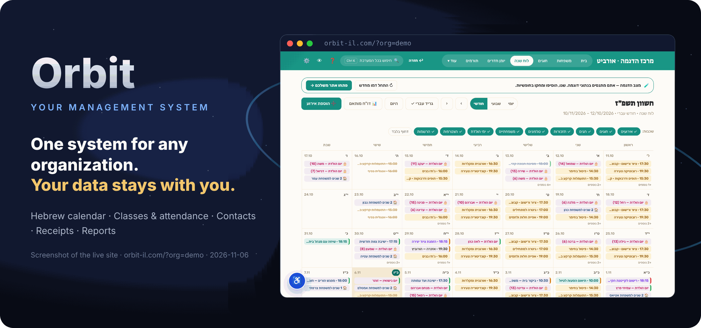
</picture>

<p align="center">
<a href="https://orbit-il.com/?org=demo"></a>
<a href="https://github.com/meir7651231-ui/maor-system/actions/workflows/deploy.yml"></a>
</p>
<p align="center">


</p>

<h3 align="center">One management system that adapts to any organization — and your data stays with you.</h3>

<p align="center"><a href="#the-problem"><b>The problem</b></a> · <a href="#how-it-works">How it works</a> · <a href="#whats-inside">What's inside</a> · <a href="#see-it">See it</a> · <a href="#run-locally-in-20-seconds">Run locally</a> · <a href="#when-to-choose-orbit--and-when-not-to">When to choose it</a> · <a href="#what-it-does-not-do">What it does not do</a> · <a href="#documentation">Docs</a> · <a href="#faq">FAQ</a></p>

---

<p align="center"><a href="https://orbit-il.com/?org=demo">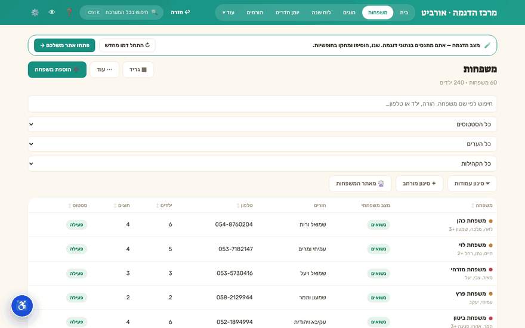</a></p>
<p align="center"><sub>Tour of the live site — <code>orbit-il.com/?org=demo</code>, recorded 2026-11-06, made-up data. Click to open the demo.</sub></p>

> The product UI is in Hebrew (right-to-left). This page mirrors the [Hebrew README](README.md).

## The problem

Small organizations — non-profits, community centers, after-school programs, clinics, small businesses — run their day across spreadsheets, WhatsApp and notebooks.
"Big" management software needs a server, a monthly subscription and a long setup, and rarely handles the Hebrew calendar, Israeli §46 donation receipts or a right-to-left interface.

**Orbit** is a single static site: the same code, a different configuration per organization, and data kept on the organization's own device — with a cloud only for those who opt in.

<picture>
  <source media="(prefers-color-scheme: light)" srcset="assets/beforeafter.en.light.svg">
  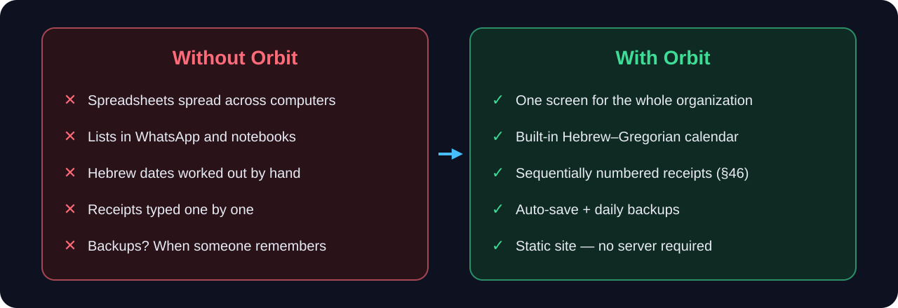
</picture>

## How it works

<picture>
  <source media="(prefers-color-scheme: light)" srcset="assets/how.en.light.svg">
  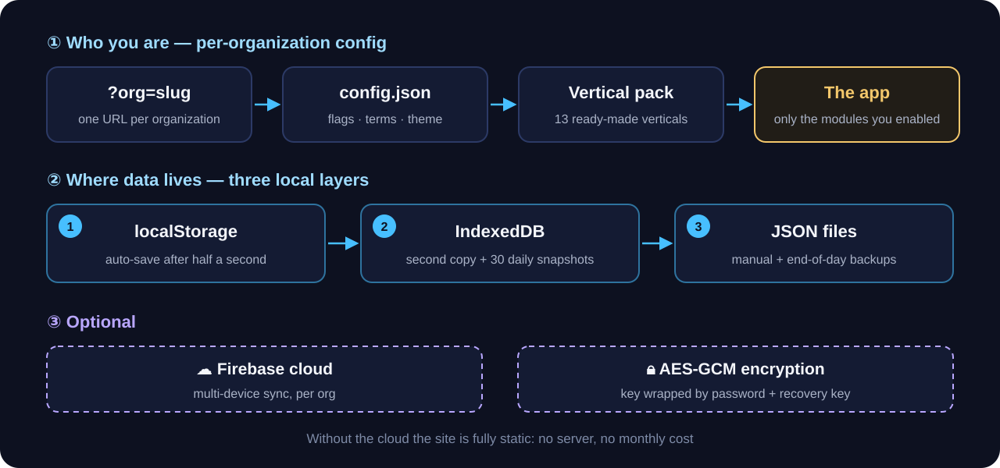
</picture>

1. **Who you are** — the URL `?org=<slug>` loads `public/c/<slug>/config.json`: feature flags (a missing key means on, only `false` turns off), terms (what you call a "family", "class" or "donor"), a theme and a vertical pack.
2. **Where data lives** — three browser layers: `localStorage` (auto-save half a second after each change) → `IndexedDB` (second copy + a ring of 30 daily snapshots) → JSON backup files (manual + end-of-day).
3. **Optional** — per-organization Firebase sync, and encryption at rest (AES-GCM 256, a data key wrapped by a PBKDF2 password and by a recovery key).

The full picture, including the gate chain and key decisions: [`docs/ARCHITECTURE.md`](docs/ARCHITECTURE.md).

## What's inside

<picture>
  <source media="(prefers-color-scheme: light)" srcset="assets/modules.en.light.svg">
  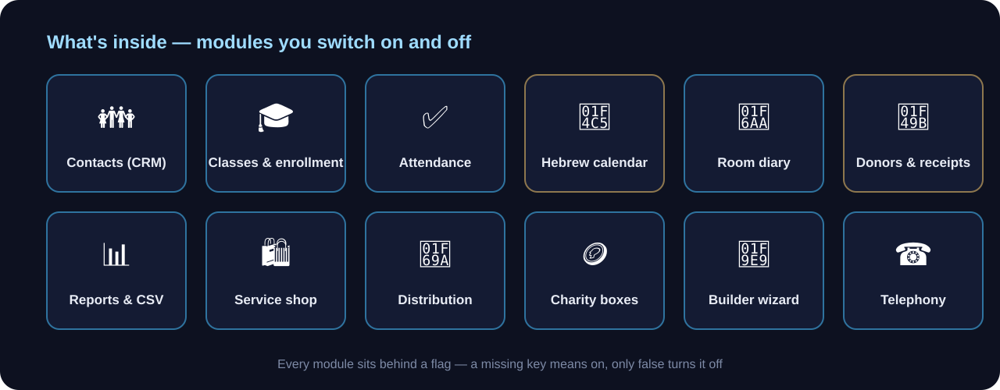
</picture>

<details><summary>As a table, with code locations</summary>

| Area | What it does | Code |
|---|---|---|
| 👪 Contacts (CRM) | Families/clients and members, multiple phones, duplicate detection and merge | `src/components/families` |
| 🎓 Classes & enrollment | Punch cards and payments, inverted attendance (record only absences), waiting list | `src/components/courses` |
| 📅 Calendar | Hebrew–Gregorian, holidays, recurrence by Hebrew date — built on `Intl` only | `src/components/calendar` · `src/lib/hebrew.ts` |
| 🚪 Room diary | Room booking, blocking on Shabbat, holidays and fast days | `src/components/diary` |
| 💛 Donors & receipts | Donations, standing orders, sequentially numbered receipts (§46) | `src/components/supporters` |
| 📊 Reports | Printing and CSV export | `src/components/reports` |
| 🛍 Isolated modules | Service shop, distribution days & volunteers, charity boxes — each in its own column | `shop` · `shop7` · `tzedaka` |
| 🧩 Builder wizard | Pick a vertical ⇒ modules, terms, theme and icon | `src/components/builder` · `src/lib/verticalPacks.ts` |
| ☁ Platform | Sign-up ⇒ approval ⇒ a site per organization; org-manager and staff hierarchy | `src/components/platform` |
| 🔒 Lock & encryption | PIN lock, encryption at rest, privacy mode | `src/components/lock` · `src/lib/crypto.ts` |

</details>

**13 ready-made vertical packs** (non-profit, clinic, retail, services, space rental, fleet, garage, hospitality, equipment lending (gemach), fundraising campaigns, digital studio, construction, studio + construction) and **4 themes**.

<picture>
  <source media="(prefers-color-scheme: light)" srcset="assets/numbers.en.light.svg">
  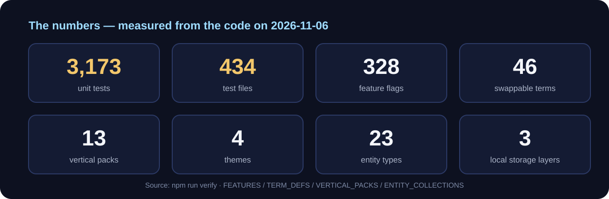
</picture>

## See it

**Screenshots of the live site** [orbit-il.com/?org=demo](https://orbit-il.com/?org=demo), taken on 2026-11-06 (desktop and iPhone, DPR 2). Made-up data only, no cloud. Click to enlarge. All screenshots live in [`docs/screenshots/`](docs/screenshots/).

<table>
<tr>
<td width="33%" align="center"><a href="docs/screenshots/calendar.png">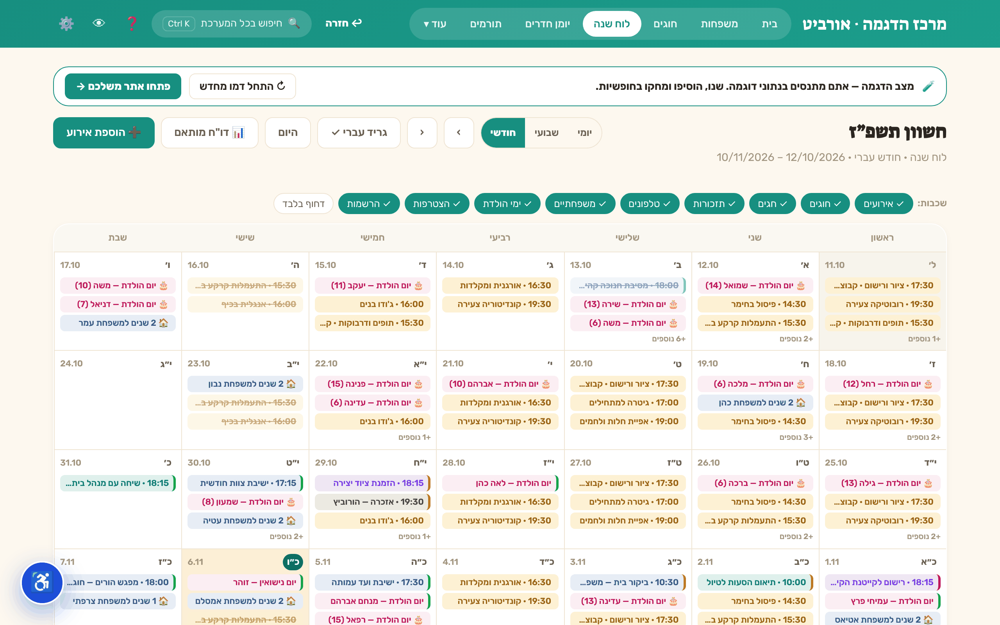</a><br><sub>📅 Hebrew–Gregorian calendar</sub></td>
<td width="33%" align="center"><a href="docs/screenshots/families.png">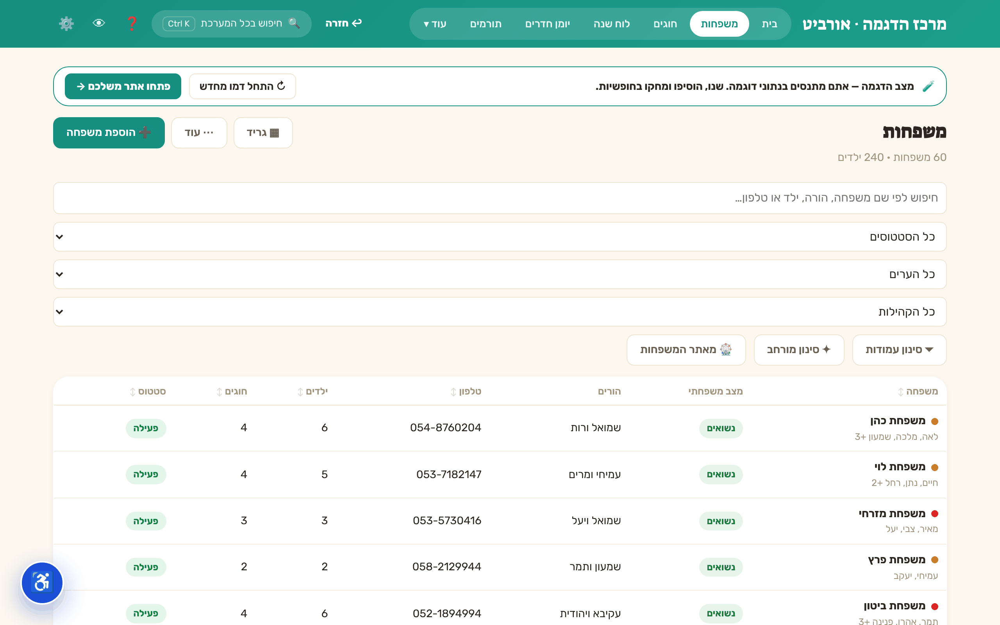</a><br><sub>👪 List, filters, search</sub></td>
<td width="33%" align="center"><a href="docs/screenshots/guide/02-family-card.png">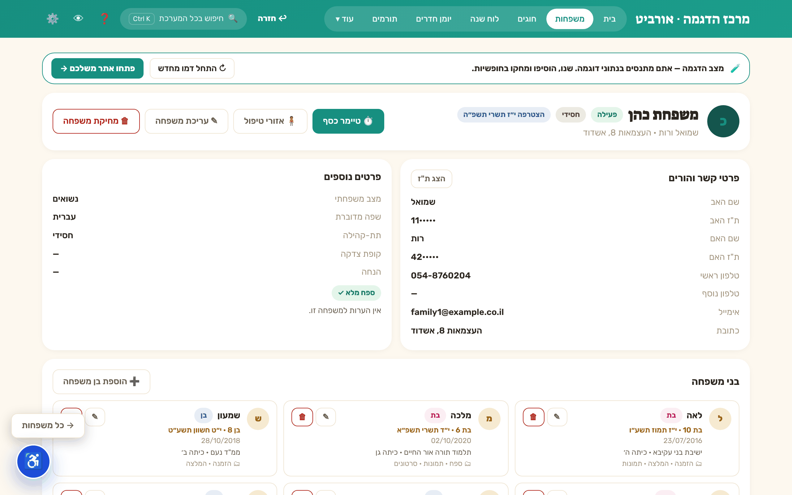</a><br><sub>🗂 Family card</sub></td>
</tr>
<tr>
<td align="center"><a href="docs/screenshots/courses.png">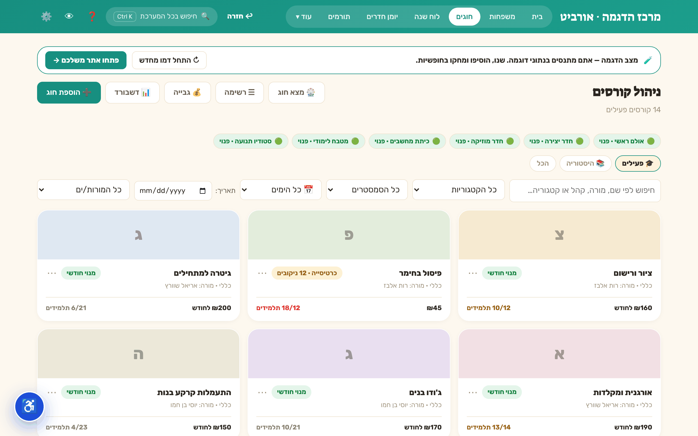</a><br><sub>🎓 Classes</sub></td>
<td align="center"><a href="docs/screenshots/diary.png">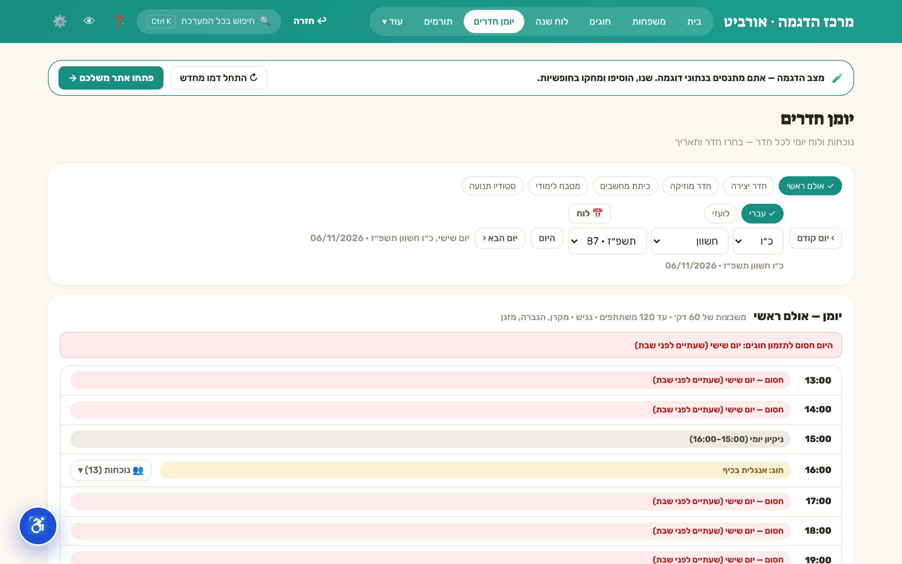</a><br><sub>🚪 Room diary</sub></td>
<td align="center"><a href="docs/screenshots/guide/07-theme.png">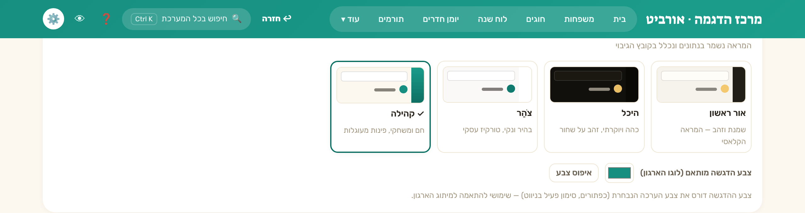</a><br><sub>🎨 Themes</sub></td>
</tr>
<tr>
<td align="center"><a href="docs/screenshots/guide/03-search.png">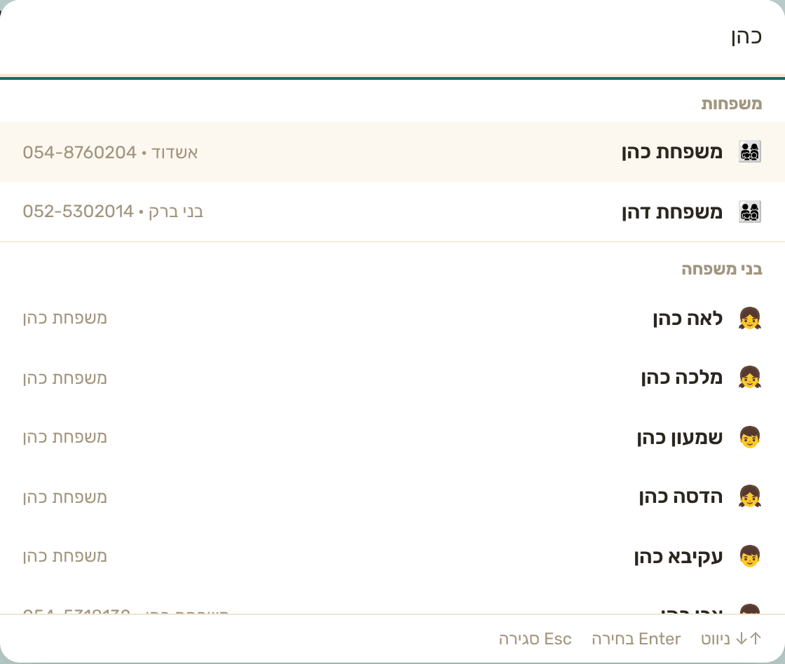</a><br><sub>🔍 Quick search Ctrl+K</sub></td>
<td align="center"><a href="docs/screenshots/guide/04-add-event.png">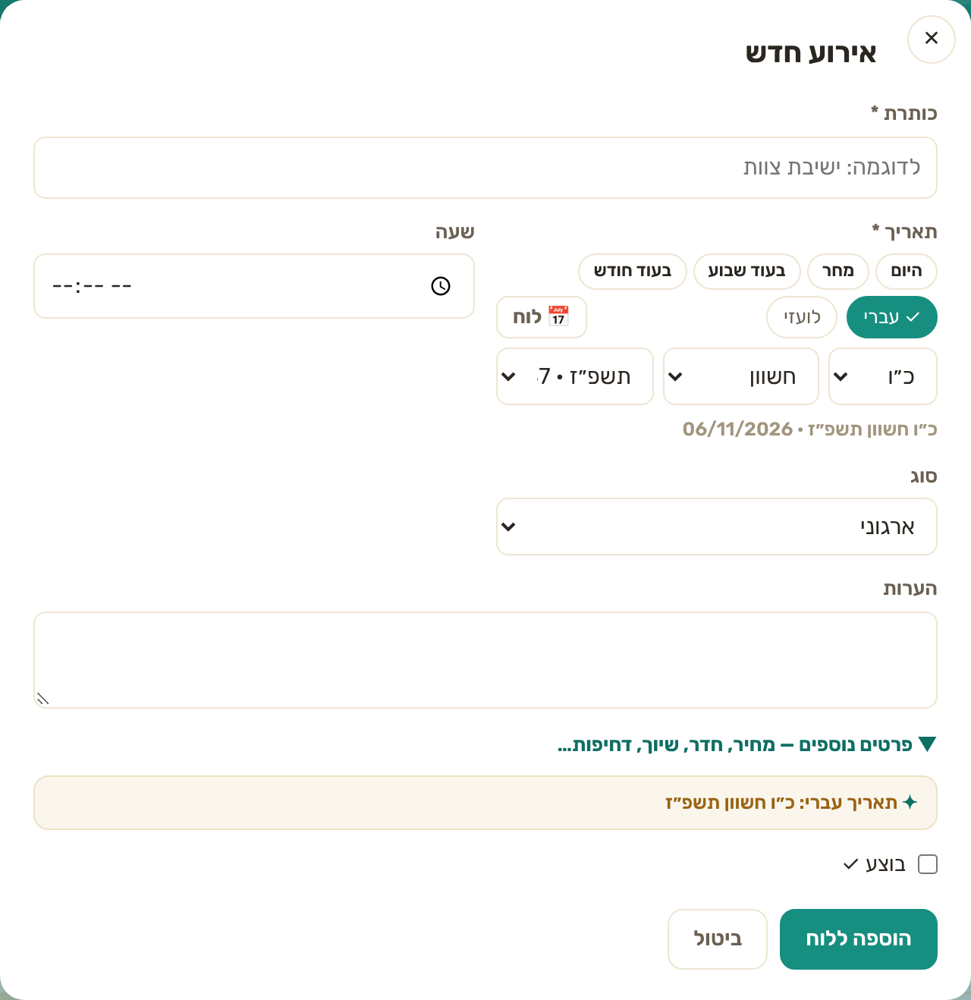</a><br><sub>➕ Event on a Hebrew date</sub></td>
<td align="center"><a href="docs/screenshots/guide/08-accessibility.png">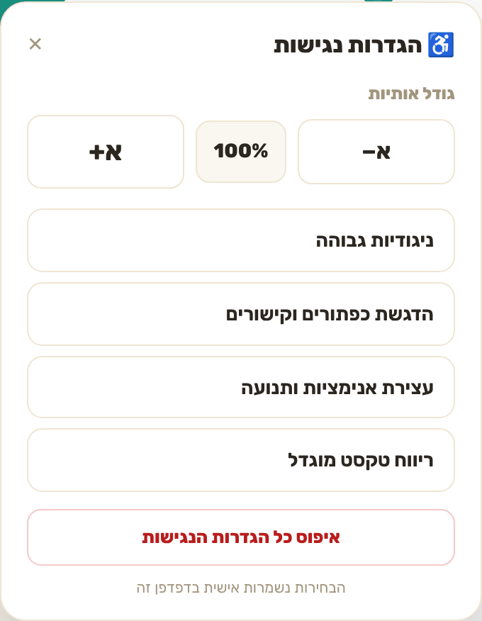</a><br><sub>♿ Accessibility</sub></td>
</tr>
<tr>
<td colspan="3" align="center"><sub>📱 iPhone</sub><br>
<a href="docs/screenshots/mobile/families.png">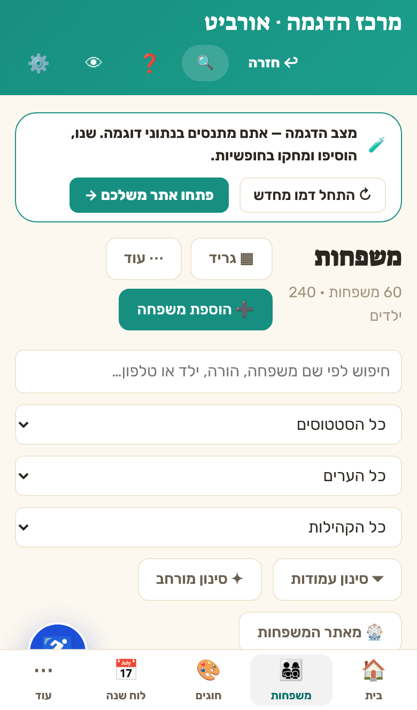</a>
<a href="docs/screenshots/mobile/family-card.png">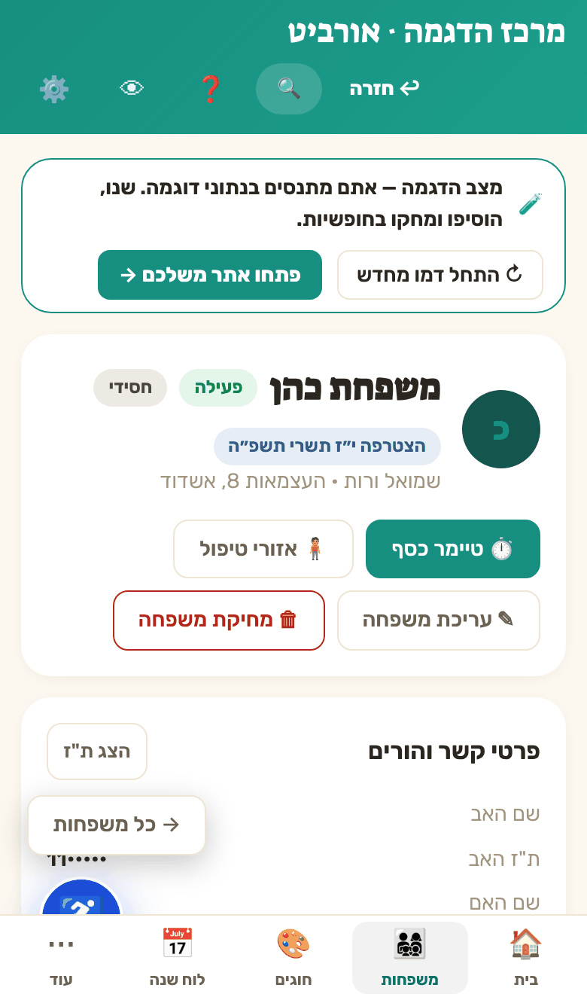</a>
<a href="docs/screenshots/mobile/calendar.png">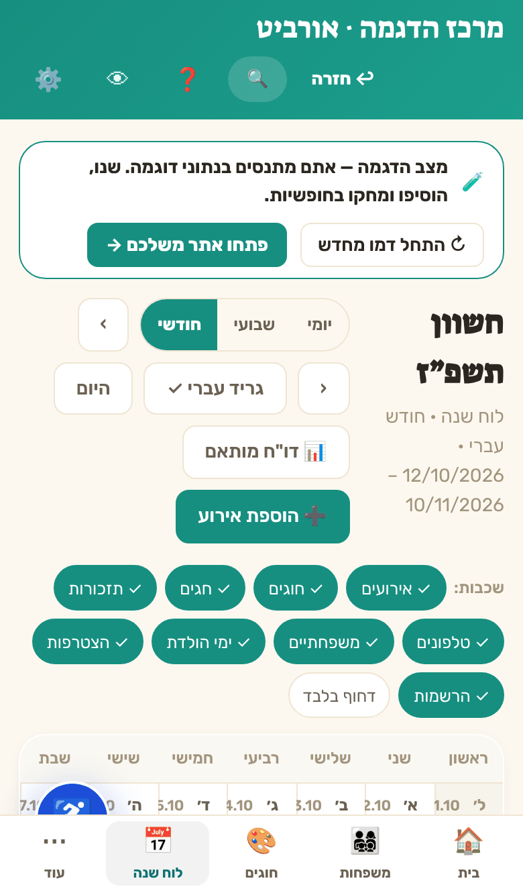</a>
<a href="docs/screenshots/mobile/search.png">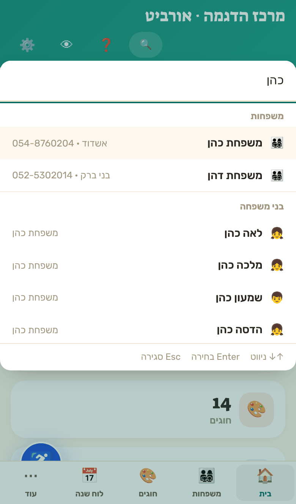</a>
</td>
</tr>
</table>

Step-by-step instructions for each (in Hebrew, like the UI): [`docs/GUIDE.he.md`](docs/GUIDE.he.md).

## Run locally in 20 seconds

<picture>
  <source media="(prefers-color-scheme: light)" srcset="assets/install.en.light.svg">
  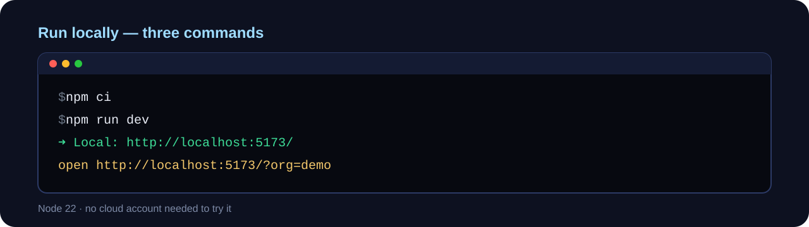
</picture>

Requires Node 22 (see `.nvmrc`).

```bash
git clone https://github.com/meir7651231-ui/maor-system.git && cd maor-system
npm ci
npm run dev          # → http://localhost:5173/?org=demo
```

**Measured from a clean clone (2026-11-06, Node 22.23):** clone 2.2 s · `npm ci` 15.2 s · dev server ready 0.7 s — **18.2 s in total** until the demo is up. With an empty npm cache, `npm ci` took 13.7 s (network-dependent).

```bash
npm run verify:fast  # typecheck → lint → unit tests (no build)
npm run verify       # full gate: + build
npm run e2e          # browser matrix (needs a build first)
```

`npm run build` outputs a static `dist/` folder (relative paths) that can be served from any static host.
Git hooks live in `.githooks/`: typecheck, lint and tests before a commit; a full build before a push, and pushing to `main` is blocked.

## When to choose Orbit — and when not to

| ✅ A good fit when you… | ❌ Not a good fit when you… |
|---|---|
| manage **families, classes, attendance and donors** — non-profits, community and religious centers, schools | need **built-in card processing** (Orbit only links to the organization's own payment page) |
| need a real **Hebrew calendar**: holidays, Hebrew dates, recurrence by Hebrew date | need **accounting** or tax-authority reporting |
| issue **sequentially numbered receipts** (§46) | have staff working in **a language other than Hebrew** (the management UI is Hebrew only) |
| want **your data to stay with you**, with no required server or subscription | need **MFA** or enterprise SSO today |
| run **several organizations** from one build (white-label) | need **multi-device work without a cloud** (sync requires Firebase) |

## What it does not do

- **It does not process card payments.** Payment links lead to the organization's own payment page; the server webhook only records an "incoming payment" for approval and never issues a receipt by itself.
- **It is not accounting software** and does not report to tax authorities. It produces sequentially numbered receipts, nothing more.
- **Without the cloud there is no multi-device sync.** In local mode data lives in one browser; backups (daily JSON files) are the organization's responsibility.
- **It does not send SMS or email without a server.** Those queues need Firebase Functions deployed and each organization's own sending credentials in its vault.
- **There is no two-factor authentication (MFA).** Cloud sign-in is email + password only.
- **The management UI is built for Hebrew (RTL).** The app itself has no language switch.

## Documentation

| Document | What's in it |
|---|---|
| [`docs/ARCHITECTURE.md`](docs/ARCHITECTURE.md) · [עברית](docs/ARCHITECTURE.he.md) | Gate chain, data layers, sync and key decisions |
| [`docs/GUIDE.he.md`](docs/GUIDE.he.md) | 9 common tasks, step by step with screenshots (Hebrew) |
| [`CONTRIBUTING.md`](CONTRIBUTING.md) | Setup, gates, conventions, pull requests |
| [`ROADMAP.md`](ROADMAP.md) | What is planned and in what state |
| [`CHANGELOG.md`](CHANGELOG.md) | History in Keep a Changelog format + a SemVer proposal |
| [`SECURITY.md`](SECURITY.md) | Private vulnerability reporting |

## Code layout

```
├── src/
│   ├── App.tsx            # shell: navigation, gate chain (decrypt → cloud → lock)
│   ├── types/             # data model (domain.ts), flags & terms (features.ts), config
│   ├── store/             # Zustand: useApp.ts (actions), persist.ts (persistence + migration), cloudSync.ts
│   ├── lib/               # pure logic: Hebrew calendar, crypto, receipts, import/export, config
│   ├── components/        # one module per area — pure lib.ts + components + __tests__
│   └── styles/            # themes, RTL, accessibility, print
├── public/                # PWA (manifest, sw.js), icons, sample configs (c/<slug>/)
├── functions/             # optional Firebase Functions (nightly backup, mail/SMS outboxes, …)
├── telephony/             # config-as-data PBX routing engine
├── e2e/                   # Playwright scripts (user journeys, matrices, Rules red-team)
├── scripts/               # build tools (bundle budget, icons, screenshots)
├── docs/                  # architecture, user guide, screenshots
├── knowledge/             # planning docs, audits and close-out reports (Hebrew)
├── firestore.rules        # cloud security rules
└── assets/                # README images (dark + light variants)
```

Each module is a pure `lib.ts` (no store/DOM) with unit tests, plus components on top. Every fixed bug gets a "ratchet" test that keeps it fixed.

## FAQ

<details><summary><b>Does it need a server?</b></summary>

No. Without the cloud the site is fully static. Firebase (sync, sign-up, Functions) is opt-in per organization via `config.json`, and is loaded dynamically only when configured.
</details>

<details><summary><b>Where is data stored, and how do I not lose it?</b></summary>

In the device's browser, in three layers. In local-only mode: use the same computer and browser, keep the daily backup files in a synced folder, avoid private browsing and don't clear site data. Moving computers = export a backup ⇒ import it in Settings.
</details>

<details><summary><b>What happens to what I do in the live demo?</b></summary>

The demo runs without a cloud, so every change stays in your own browser only. The **↻** restart-demo button in the demo banner brings back the sample data.
</details>

<details><summary><b>Can it be adapted to our field?</b></summary>

Yes — through the builder wizard or `config.json`: a vertical pack, modules and flags on or off, custom terms, theme and color.
</details>

<details><summary><b>Can it be installed as an app?</b></summary>

Yes. It's a PWA (manifest + service worker), installable to the home screen and usable offline after the first load.
</details>

## Status

In active development and used in production; currently in a feature freeze (see [`ROADMAP.md`](ROADMAP.md)).
There is currently no license file in this repository, so no rights are granted beyond viewing the code.
