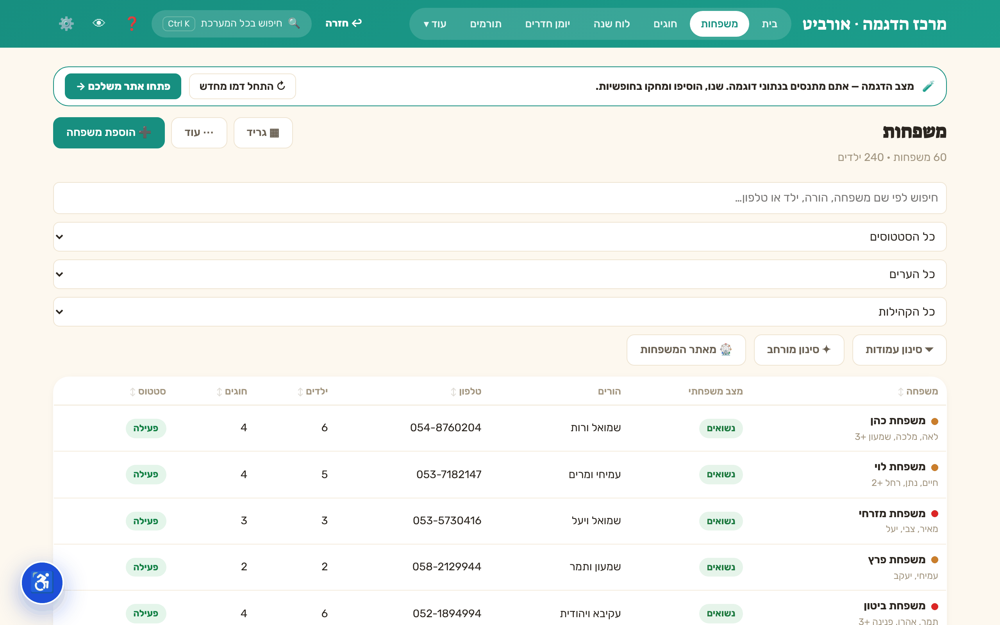
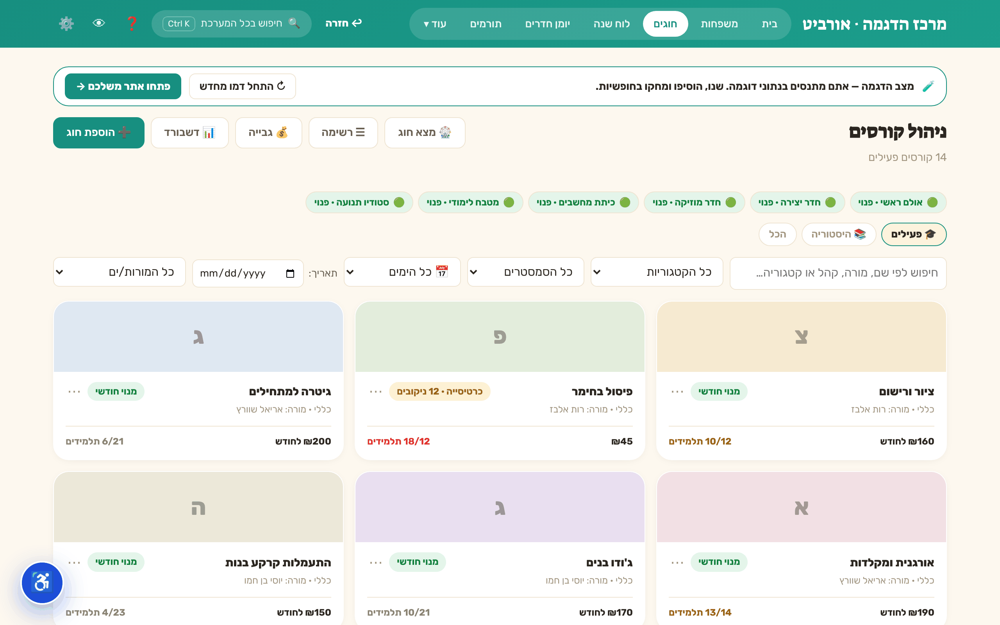
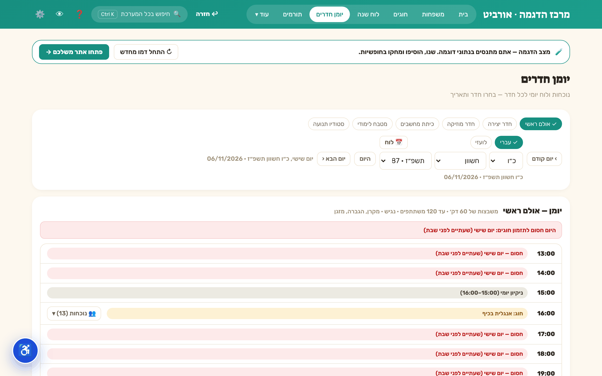

<p align="right"><b>עברית</b> · <a href="README.en.md">English</a></p>

<div dir="rtl">

<p align="center"></p>

<p align="center">


</p>

<h3 align="center">מערכת ניהול אחת שמתלבשת על כל ארגון — והנתונים נשארים אצלכם.</h3>

<p align="center"><a href="#הבעיה"><b>הבעיה</b></a> · <a href="#איך-זה-עובד">איך זה עובד</a> · <a href="#מה-יש-בפנים">מה יש בפנים</a> · <a href="#ככה-זה-נראה">ככה זה נראה</a> · <a href="#הרצה-מקומית">הרצה מקומית</a> · <a href="#מה-זה-לא-עושה">מה זה לא עושה</a> · <a href="#מבנה-הקוד">מבנה הקוד</a> · <a href="#שאלות-נפוצות">שאלות נפוצות</a> · <a href="#סטטוס">סטטוס</a></p>

---

<p align="center"></p>
<p align="center"><sub>סיור בדמו — <code>?org=demo</code>, נתונים מומצאים בלבד</sub></p>

## הבעיה

ארגונים קטנים — עמותות, חוגים, קליניקות, עסקים קטנים — מנהלים את היום-יום בין גיליונות, וואטסאפ ומחברות.
תוכנות ניהול "גדולות" דורשות שרת, מנוי חודשי והתאמה ארוכה, ובדרך כלל לא יודעות לוח עברי, קבלות לפי סעיף 46 או ממשק מימין לשמאל.

**אורביט** היא אתר סטטי אחד: אותו קוד, קונפיגורציה שונה לכל ארגון, והנתונים נשמרים במכשיר של הארגון עצמו — עם ענן רק למי שבוחר בו.

<p align="center"></p>

## איך זה עובד

<p align="center"></p>

1. **מי אתם** — הכתובת `?org=<slug>` טוענת את `public/c/<slug>/config.json`: דגלי-פיצ'ר (מפתח חסר = פעיל, רק `false` מכבה), מונחים (איך קוראים אצלכם ל"משפחה", "חוג", "תורם"), ערכת נושא וחבילת-תחום.
2. **איפה הנתונים** — שלוש שכבות בדפדפן: `localStorage` (שמירה אוטומטית אחרי חצי שנייה) ← `IndexedDB` (עותק שני + טבעת של 30 צילומים יומיים) ← קובצי גיבוי JSON (ידני + אוטומטי בסוף יום). שחזור מכל שכבה דרך מסך ההגדרות.
3. **לפי בחירה** — סנכרון ענן Firebase פר-ארגון, והצפנה במנוחה (AES-GCM 256, מפתח-נתונים עטוף בסיסמה ‏PBKDF2 ובמפתח-שחזור).

## מה יש בפנים

<p align="center"></p>

<details><summary>כטבלה, עם מיקום הקוד</summary>

| תחום | מה הוא עושה | קוד |
|---|---|---|
| 👪 אנשי-קשר (CRM) | משפחות/לקוחות ובני-בית, טלפונים מרובים, איתור כפילויות ומיזוג | `src/components/families` |
| 🎓 חוגים ושיבוצים | כרטיסיות ותשלומים, נוכחות במודל הפוך (רושמים רק חיסורים), רשימת המתנה | `src/components/courses` |
| 📅 לוח שנה | עברי-לועזי, חגים וחזרתיות לפי תאריך עברי — על `Intl` בלבד, בלי ספרייה חיצונית | `src/components/calendar` · `src/lib/hebrew.ts` |
| 🚪 יומן חדרים | תפיסת חדרים, חסימת חגים וצומות | `src/components/diary` |
| 💛 תורמים וקבלות | תרומות, הוראות-קבע, קבלות במספור רציף (סעיף 46) | `src/components/supporters` |
| 📊 דוחות | הדפסה וייצוא CSV | `src/components/reports` |
| 🛍 מודולים מבודדים | חנות שירותים, ימי-חלוקה ומתנדבים, קופות צדקה — כל אחד בעמודה נפרדת | `shop` · `shop7` · `tzedaka` |
| 🧩 אשף-הרכבה | בחירת תחום ⇒ מודולים, מונחים, ערכת נושא ואייקון | `src/components/builder` · `src/lib/verticalPacks.ts` |
| ☁ פלטפורמה | הרשמה ⇒ אישור ⇒ אתר לארגון; היררכיית מנהל-ארגון ועובדות | `src/components/platform` |
| 🔒 נעילה והצפנה | נעילת PIN, הצפנה במנוחה, מצב צנעה | `src/components/lock` · `src/lib/crypto.ts` |

</details>

**13 חבילות-תחום מוכנות** (עמותת חסד, קליניקה, חנות, שירותים, השכרת חללים, צי רכב, מוסך, אירוח, גמ"ח, מבצעי התרמה, סטודיו דיגיטל, בנייה, סטודיו+בנייה) ו-**4 ערכות נושא**.

<p align="center"></p>

## ככה זה נראה

צילומים אמיתיים של האפליקציה בדמו (`?org=demo` — נתונים מומצאים, בלי ענן):

<table>
<tr><td width="50%"><br><sub>📅 לוח שנה עברי-לועזי</sub></td><td width="50%"><br><sub>👪 אנשי-קשר — רשימה, סינון, חיפוש</sub></td></tr>
<tr><td><br><sub>🎓 חוגים — תפוסה, מורה, חדר</sub></td><td><br><sub>🚪 יומן חדרים — כולל חסימת חגים</sub></td></tr>
</table>

## הרצה מקומית

<p align="center"></p>

דרישות: Node 22 (ראו `.nvmrc`).

<div dir="ltr">

```bash
npm ci
npm run dev          # שרת פיתוח — פתחו http://localhost:5173/?org=demo לדמו עם נתונים לדוגמה
npm run verify:fast  # typecheck → lint → בדיקות יחידה (בלי build)
npm run verify       # השער המלא: + build
npm run e2e          # מטריצת דפדפן (דורש build קודם)
```

</div>

הפלט של `npm run build` הוא תיקיית `dist` סטטית (נתיבים יחסיים) — עולה לכל אחסון סטטי.
ב-repo מוגדרים hooks בתיקייה ‎`.githooks`‎: לפני commit רצים typecheck, lint ובדיקות; לפני push רץ build מלא, ו-push ל-main נחסם.

## מה זה לא עושה

כדי שלא יהיו הפתעות:

- **לא סולקת כרטיסי אשראי.** קישורי-תשלום מובילים לעמוד-הסליקה של הארגון עצמו. ה-webhook בשרת רק רושם "תשלום נכנס" שממתין לאישור, ולא מנפיק קבלה לבד.
- **אינה מערכת הנהלת-חשבונות** ואינה מדווחת לרשויות המס. היא מפיקה קבלות במספור רציף, וזה הכול.
- **בלי ענן אין סנכרון בין מכשירים.** במצב מקומי הנתונים נמצאים בדפדפן אחד, והגיבוי הוא באחריות הארגון (קובצי JSON יומיים).
- **לא שולחת SMS או מייל בלי שרת.** התורים האלה דורשים פריסת Firebase Functions ופרטי-שליחה של כל ארגון בכספת שלו.
- **אין אימות דו-שלבי (MFA).** הכניסה לענן היא באימייל וסיסמה בלבד.
- **ממשק הניהול בנוי לעברית ומימין לשמאל.** אין מתג-שפה לאפליקציה עצמה.

## מבנה הקוד

<div dir="ltr">

```
├── src/
│   ├── App.tsx            # שלד: ניווט, שרשרת שערים (פענוח → ענן → נעילה)
│   ├── types/             # מודל הנתונים (domain.ts), דגלים ומונחים (features.ts), קונפיג
│   ├── store/             # Zustand: useApp.ts (פעולות), persist.ts (התמדה+מיגרציה), cloudSync.ts
│   ├── lib/               # לוגיקה טהורה: לוח עברי, הצפנה, קבלות, ייבוא/ייצוא, קונפיג
│   ├── components/        # מודול לכל תחום — lib.ts טהור + רכיבים + __tests__
│   └── styles/            # ערכות נושא, RTL, נגישות, הדפסה
├── public/                # PWA (manifest, sw.js), אייקונים, קונפיגים לדוגמה (c/<slug>/)
├── functions/             # Firebase Functions אופציונליות (גיבוי-לילה, תורי מייל/SMS ועוד)
├── telephony/             # מנוע מרכזייה מתצורה (config → ניתוב שיחות)
├── e2e/                   # סקריפטי Playwright (מסעות משתמש, מטריצות, red-team ל-Rules)
├── scripts/               # כלי build (תקציב בנדל, אייקונים, צילומים)
├── knowledge/             # מסמכי תכנון, ביקורות ודוחות סגירה
├── firestore.rules        # כללי אבטחה לענן
└── assets/                # נכסי ה-README
```

</div>

כל מודול בנוי כ-`lib.ts` טהור (בלי store/DOM) שנבדק ביחידה, ורכיבים מעליו. באג שתוקן מקבל בדיקת "ratchet" שמונעת חזרה.

## שאלות נפוצות

<details><summary><b>צריך שרת?</b></summary>

לא. בלי ענן האתר סטטי לחלוטין. Firebase (סנכרון, הרשמה, Functions) הוא opt-in פר-ארגון דרך `config.json`, ונטען דינמית רק כשמוגדר.
</details>

<details><summary><b>איפה הנתונים נשמרים, ואיך לא מאבדים אותם?</b></summary>

בדפדפן של המכשיר, בשלוש שכבות (ראו <a href="#איך-זה-עובד">איך זה עובד</a>). במצב מקומי-בלבד: לעבוד מאותו מחשב ודפדפן, לשמור את קובצי הגיבוי היומיים בתיקייה מסונכרנת, לא לעבוד בגלישה פרטית ולא לנקות נתוני-אתר. מעבר מחשב = ייצוא גיבוי ⇒ ייבוא במסך ההגדרות.
</details>

<details><summary><b>אפשר להתאים לתחום שלנו?</b></summary>

כן — דרך אשף ההרכבה או `config.json`: חבילת-תחום, הדלקה/כיבוי של מודולים ודגלים, שינוי מונחים, ערכת נושא וצבע.
</details>

<details><summary><b>אפשר להתקין כאפליקציה?</b></summary>

כן, האתר הוא PWA (manifest + service worker) וניתן להתקנה למסך הבית; עובד גם בלי אינטרנט אחרי הטעינה הראשונה.
</details>

## סטטוס

בפיתוח פעיל ובשימוש בפרודקשן. היסטוריית השינויים: [`CHANGELOG.md`](CHANGELOG.md) · דיווח על חולשות: [`SECURITY.md`](SECURITY.md).
אין כרגע קובץ רישיון ב-repo, ולכן אין הרשאת שימוש מעבר לצפייה בקוד.

</div>
