<p align="right"><b>עברית</b> · <a href="README.en.md">English</a> &nbsp;|&nbsp; ▶ <a href="https://orbit-il.com/?org=demo"><b>נסו עכשיו את הדמו החי</b></a> · <a href="#ככה-זה-נראה">סיור מצולם</a></p>

<div dir="rtl">

<picture>
  <source media="(prefers-color-scheme: light)" srcset="assets/hero.light.png">
  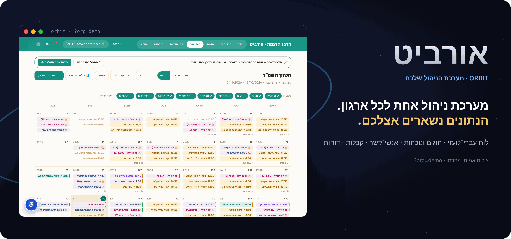
</picture>

<p align="center">
<a href="https://orbit-il.com/?org=demo"></a>
<a href="https://github.com/meir7651231-ui/maor-system/actions/workflows/deploy.yml"></a>
</p>
<p align="center">


</p>

<h3 align="center">מערכת ניהול אחת שמתלבשת על כל ארגון — והנתונים נשארים אצלכם.</h3>

<p align="center"><a href="#מתלבשת-על-כל-ארגון"><b>מתלבשת על כל ארגון</b></a> · <a href="#הבעיה">הבעיה</a> · <a href="#איך-זה-עובד">איך זה עובד</a> · <a href="#מה-יש-בפנים">מה יש בפנים</a> · <a href="#ככה-זה-נראה">ככה זה נראה</a> · <a href="#הרצה-מקומית-ב-20-שניות">הרצה מקומית</a> · <a href="#מתי-לבחור-בנו--ומתי-לא">מתי לבחור בנו</a> · <a href="#מה-זה-לא-עושה">מה זה לא עושה</a> · <a href="#תיעוד">תיעוד</a> · <a href="#שאלות-נפוצות">שאלות</a></p>

---

## מתלבשת על כל ארגון

אותו קוד ואותה בנייה. בחירת תחום אחת מחליפה **מונחים, ערכת נושא, צבע, אייקון, מבנה-מסך ותפריט**. למטה **אותו מסך עם אותם נתונים** בשלושה תחומים — שימו לב שגם שמות הרשומות מתחלפים (משפחת כהן ← מטופל כהן ← אורח כהן):

<table>
<tr>
<td width="33%" align="center"><a href="docs/screenshots/verticals/chesed.png">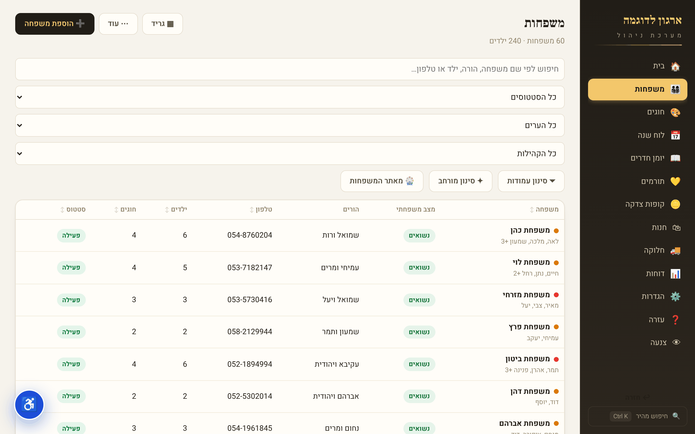</a><br><sub>🕊️ <b>עמותת חסד</b> — "משפחות" · ערכת אור ראשון · סרגל-צד · כל המודולים</sub></td>
<td width="33%" align="center"><a href="docs/screenshots/verticals/clinic.png">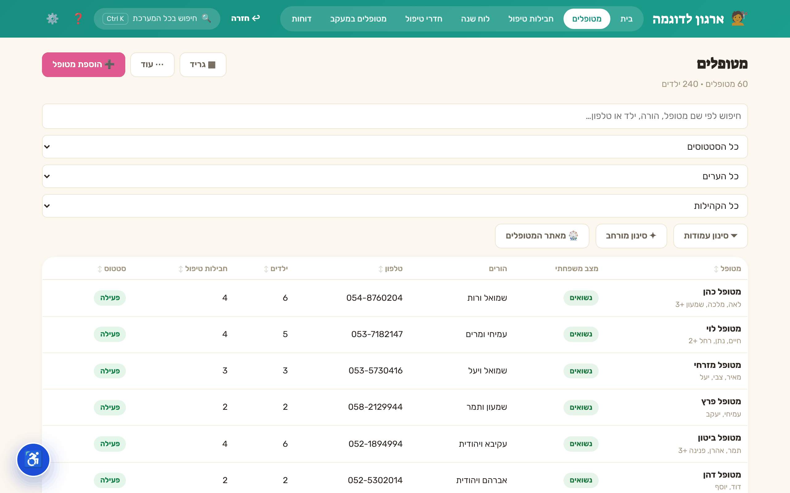</a><br><sub>💇 <b>קליניקה</b> — "מטופלים" · ערכת קהילה בוורוד · חבילות טיפול · חדרי טיפול</sub></td>
<td width="33%" align="center"><a href="docs/screenshots/verticals/hospitality.png">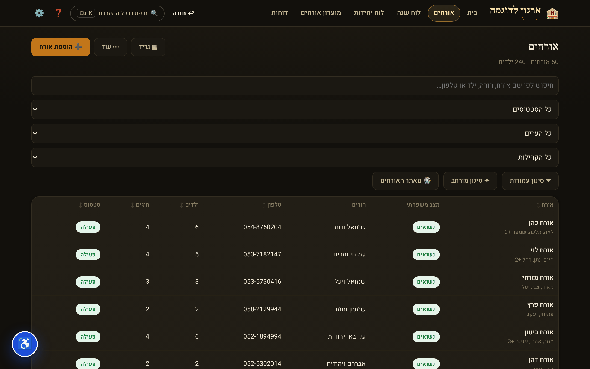</a><br><sub>🏨 <b>אירוח / צימרים</b> — "אורחים" · ערכת היכל הכהה · לוח יחידות · מועדון אורחים</sub></td>
</tr>
</table>

**איך זה קורה:**

1. **בהרשמה** הלקוח בוחר תחום — שלב 1 מתוך 5 באשף (צילום מהאתר החי). כשהבעלים מאשר את הבקשה, חבילת התחום הזה נזרעת כנקודת-הפתיחה.
2. **באשף ההרכבה** אפשר להחליף חבילה ולכוונן: להדליק ולכבות כל יכולת, ולשנות מונחים, צבע ושם.
3. הקונפיג הזה הוא כל ההבדל — הקוד אחד. מאחורי הקלעים: `applyVerticalPack` ← `termOf` / `featureOn` / `moduleOn` (פירוט ב-[ארכיטקטורה](docs/ARCHITECTURE.he.md#הליבה-קונפיג--termof--featureon--moduleon)).

<table>
<tr>
<td width="40%" align="center"><a href="docs/screenshots/verticals/signup-wizard.png">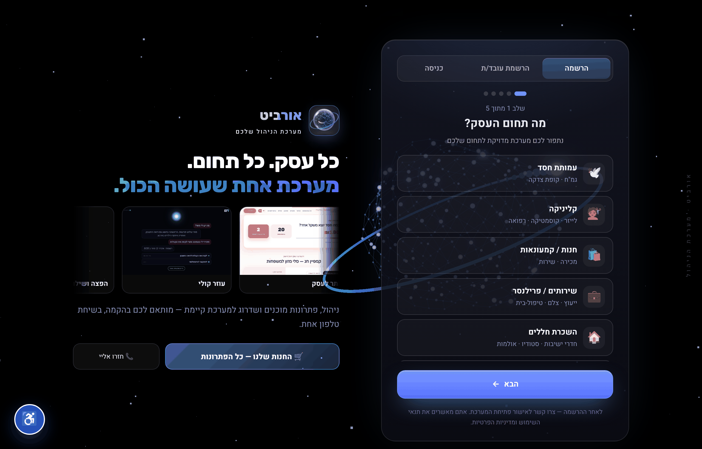</a><br><sub>① אשף ההרשמה — "מה תחום העסק?"</sub></td>
<td width="30%" align="center"><a href="docs/screenshots/verticals/builder-vertical.png">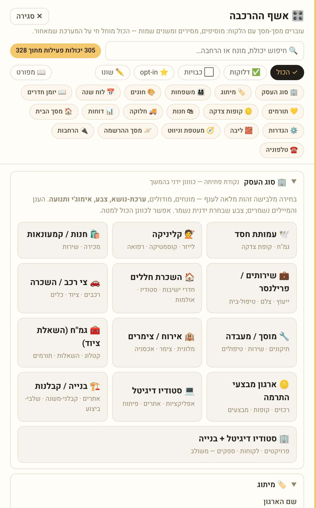</a><br><sub>② אשף ההרכבה — בחירת חבילה</sub></td>
<td width="30%" align="center"><a href="docs/screenshots/verticals/builder-toggles.png">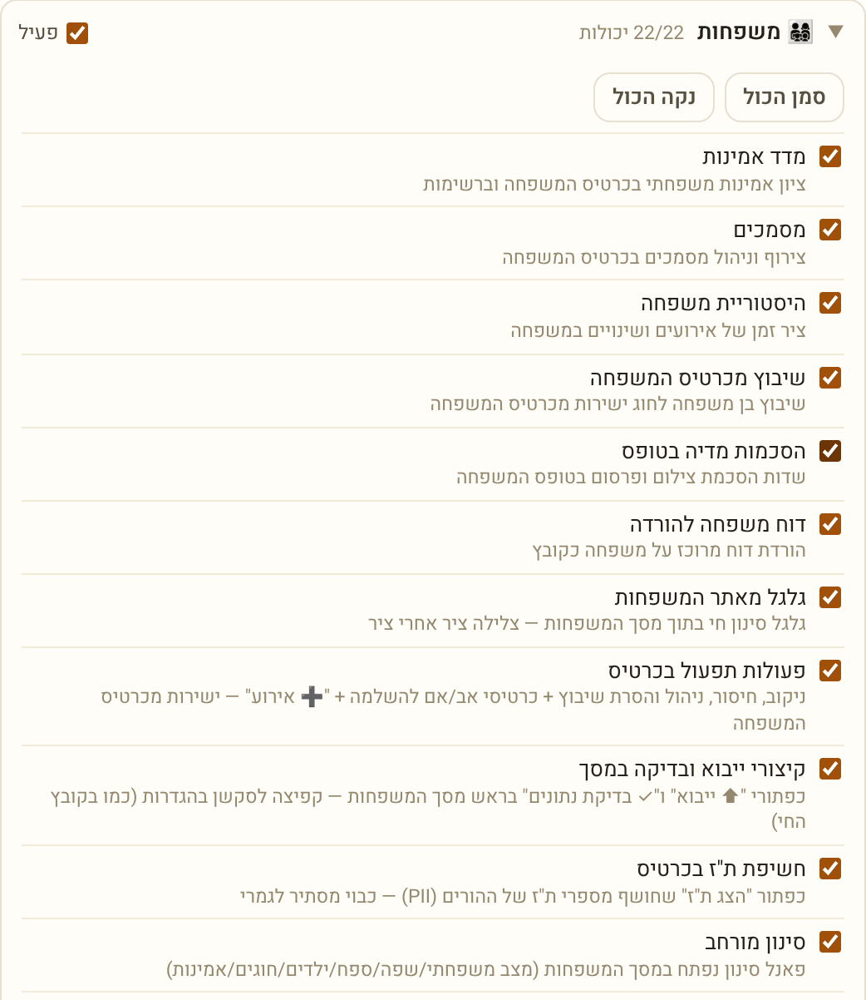</a><br><sub>③ מתג לכל יכולת</sub></td>
</tr>
</table>

**13** חבילות-תחום · **46** מונחים מתחלפים · **328** דגלי-פיצ'ר · **4** ערכות נושא — כולם נספרו מהקוד (`VERTICAL_PACKS`, `TERM_DEFS`, `FEATURES`).

<sub>שלושת צילומי התחומים: build מקומי מ-main, עם הקונפיג ש-`applyVerticalPack` מייצר לכל חבילה ועם נתוני-הדמו. אשף ההרשמה צולם מהאתר החי, אשף ההרכבה מה-build המקומי. כל הצילומים מ-7.11.2026.</sub>

<p align="center"><a href="https://orbit-il.com/?org=demo">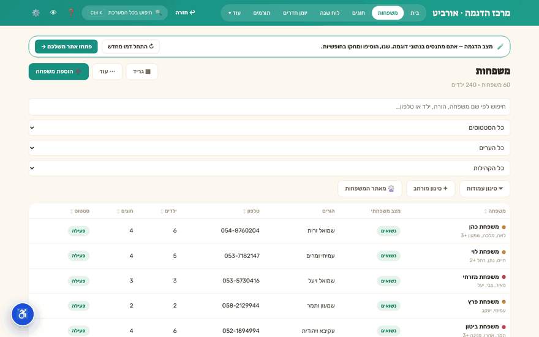</a></p>
<p align="center"><sub>סיור באתר החי — <code>orbit-il.com/?org=demo</code>, צולם ב-6.11.2026, נתונים מומצאים. לחיצה פותחת את הדמו.</sub></p>

## הבעיה

ארגונים קטנים — עמותות, מרכזים קהילתיים, חוגים, קליניקות ועסקים קטנים — מנהלים את היום-יום בין גיליונות, וואטסאפ ומחברות.
תוכנות ניהול "גדולות" דורשות שרת, מנוי חודשי והתאמה ארוכה, ובדרך כלל לא יודעות לוח עברי, קבלות לפי סעיף 46 או ממשק מימין לשמאל.

**אורביט** היא אתר סטטי אחד: אותו קוד, קונפיגורציה שונה לכל ארגון, והנתונים נשמרים במכשיר של הארגון עצמו — עם ענן רק למי שבוחר בו.

<picture>
  <source media="(prefers-color-scheme: light)" srcset="assets/beforeafter.light.svg">
  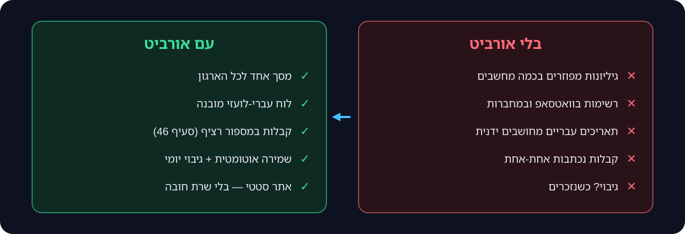
</picture>

## איך זה עובד

<picture>
  <source media="(prefers-color-scheme: light)" srcset="assets/how.light.svg">
  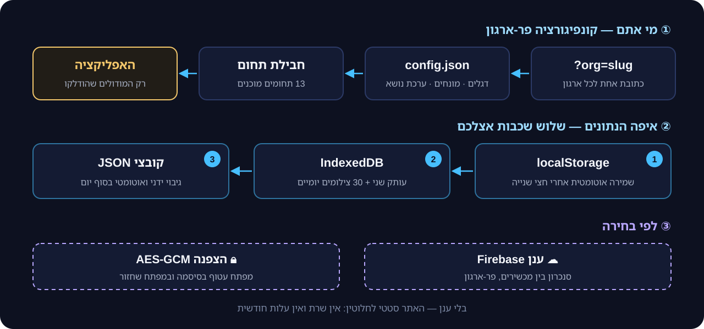
</picture>

1. **מי אתם** — הכתובת `?org=<slug>` טוענת את `public/c/<slug>/config.json`: דגלי-פיצ'ר (מפתח חסר = פעיל, רק `false` מכבה), מונחים (איך קוראים אצלכם ל"משפחה", "חוג", "תורם"), ערכת נושא וחבילת-תחום.
2. **איפה הנתונים** — שלוש שכבות בדפדפן: `localStorage` (שמירה אוטומטית אחרי חצי שנייה) ← `IndexedDB` (עותק שני + טבעת של 30 צילומים יומיים) ← קובצי גיבוי JSON (ידני + אוטומטי בסוף יום).
3. **לפי בחירה** — סנכרון ענן Firebase פר-ארגון, והצפנה במנוחה (AES-GCM 256, מפתח-נתונים עטוף בסיסמה ‏PBKDF2 ובמפתח-שחזור).

פירוט מלא, כולל שרשרת השערים והחלטות המפתח: [`docs/ARCHITECTURE.he.md`](docs/ARCHITECTURE.he.md).

## מה יש בפנים

<picture>
  <source media="(prefers-color-scheme: light)" srcset="assets/modules.light.svg">
  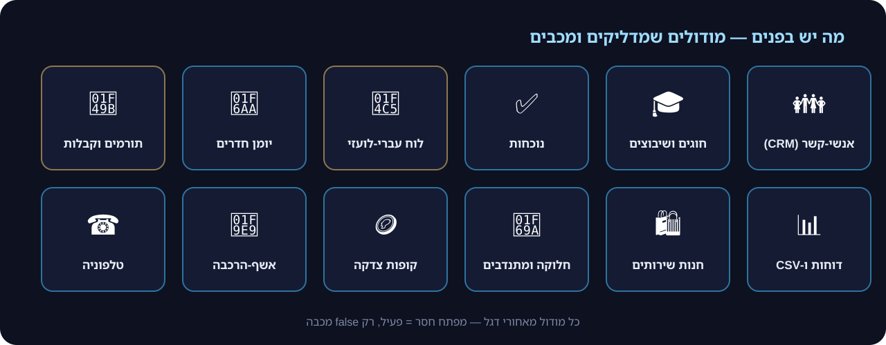
</picture>

<details><summary>כטבלה, עם מיקום הקוד</summary>

| תחום | מה הוא עושה | קוד |
|---|---|---|
| 👪 אנשי-קשר (CRM) | משפחות/לקוחות ובני-בית, טלפונים מרובים, איתור כפילויות ומיזוג | `src/components/families` |
| 🎓 חוגים ושיבוצים | כרטיסיות ותשלומים, נוכחות במודל הפוך (רושמים רק חיסורים), רשימת המתנה | `src/components/courses` |
| 📅 לוח שנה | עברי-לועזי, חגים וחזרתיות לפי תאריך עברי — על `Intl` בלבד, בלי ספרייה חיצונית | `src/components/calendar` · `src/lib/hebrew.ts` |
| 🚪 יומן חדרים | תפיסת חדרים, חסימת שבתות, חגים וצומות | `src/components/diary` |
| 💛 תורמים וקבלות | תרומות, הוראות-קבע, קבלות במספור רציף (סעיף 46) | `src/components/supporters` |
| 📊 דוחות | הדפסה וייצוא CSV | `src/components/reports` |
| 🛍 מודולים מבודדים | חנות שירותים, ימי-חלוקה ומתנדבים, קופות צדקה — כל אחד בעמודה נפרדת | `shop` · `shop7` · `tzedaka` |
| 🧩 אשף-הרכבה | בחירת תחום ⇒ מודולים, מונחים, ערכת נושא ואייקון | `src/components/builder` · `src/lib/verticalPacks.ts` |
| ☁ פלטפורמה | הרשמה ⇒ אישור ⇒ אתר לארגון; היררכיית מנהל-ארגון ועובדות | `src/components/platform` |
| 🔒 נעילה והצפנה | נעילת PIN, הצפנה במנוחה, מצב צנעה | `src/components/lock` · `src/lib/crypto.ts` |

</details>

**13 חבילות-תחום מוכנות** (עמותת חסד, קליניקה, חנות, שירותים, השכרת חללים, צי רכב, מוסך, אירוח, גמ"ח, מבצעי התרמה, סטודיו דיגיטל, בנייה, סטודיו+בנייה) ו-**4 ערכות נושא**.

<picture>
  <source media="(prefers-color-scheme: light)" srcset="assets/numbers.light.svg">
  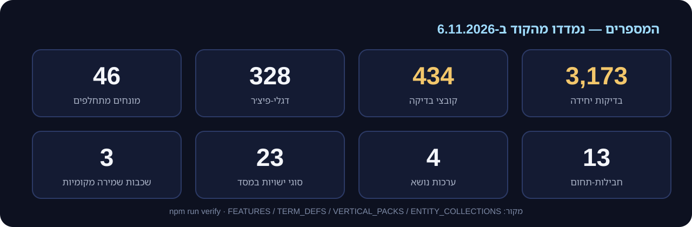
</picture>

## ככה זה נראה

**צילומים מהאתר החי** [orbit-il.com/?org=demo](https://orbit-il.com/?org=demo), נלקחו ב-6.11.2026 (דסקטופ ו-iPhone, ‏DPR 2). נתונים מומצאים בלבד, בלי ענן. לחיצה מגדילה. כל הצילומים נמצאים ב-[`docs/screenshots/`](docs/screenshots/).

<table>
<tr>
<td width="33%" align="center"><a href="docs/screenshots/calendar.png">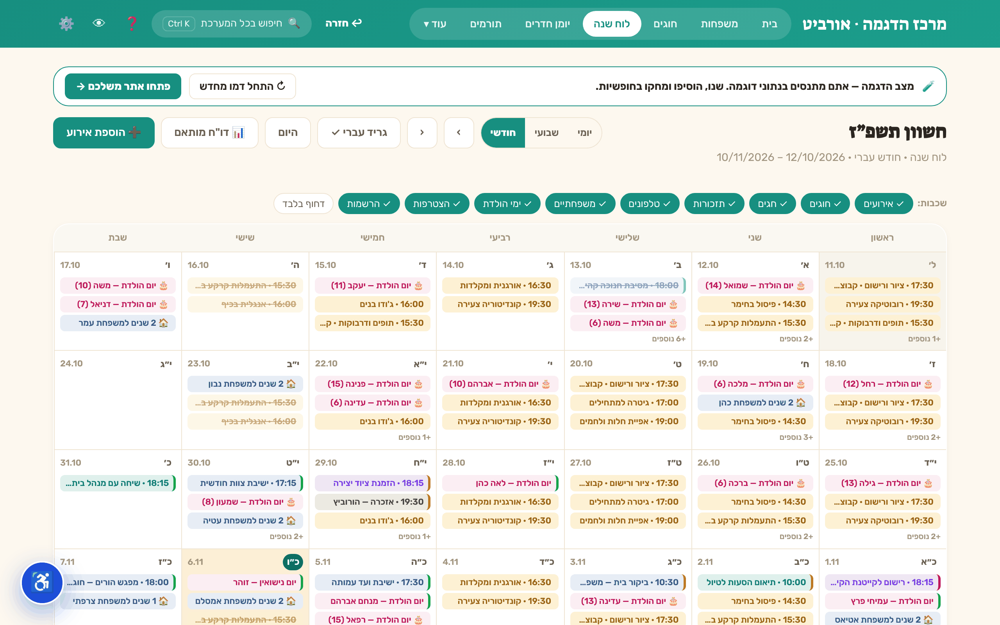</a><br><sub>📅 לוח שנה עברי-לועזי</sub></td>
<td width="33%" align="center"><a href="docs/screenshots/families.png"></a><br><sub>👪 רשימה, סינון, חיפוש</sub></td>
<td width="33%" align="center"><a href="docs/screenshots/guide/02-family-card.png">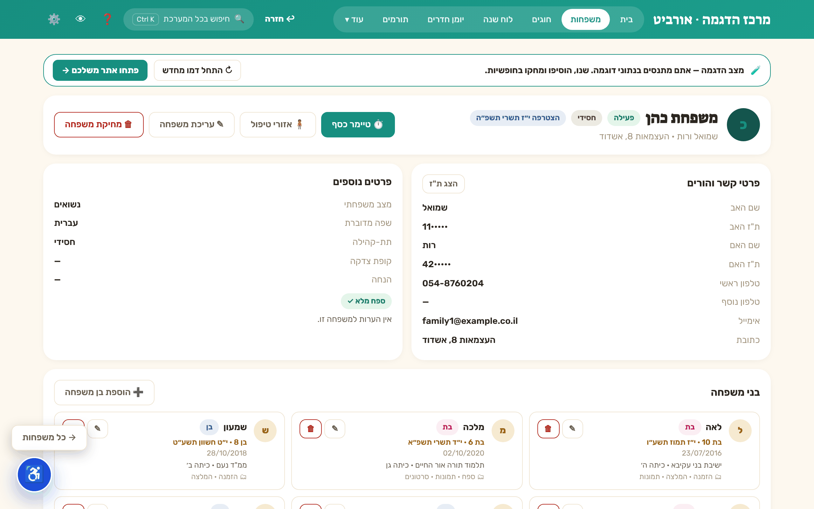</a><br><sub>🗂 כרטיס משפחה</sub></td>
</tr>
<tr>
<td align="center"><a href="docs/screenshots/guide/01-add-family.png">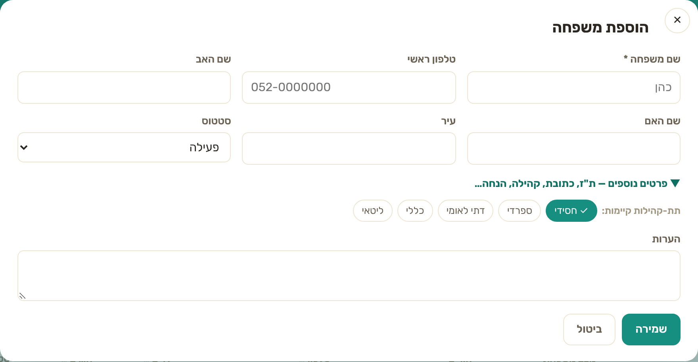</a><br><sub>➕ הוספת משפחה</sub></td>
<td align="center"><a href="docs/screenshots/diary.png"></a><br><sub>🚪 יומן חדרים</sub></td>
<td align="center"><a href="docs/screenshots/guide/07-theme.png">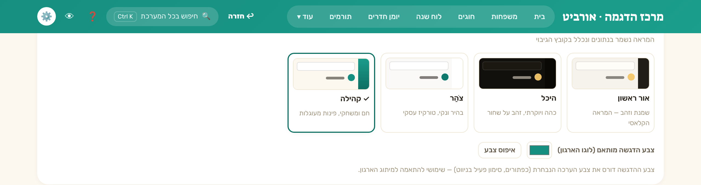</a><br><sub>🎨 ערכות נושא</sub></td>
</tr>
<tr>
<td align="center"><a href="docs/screenshots/guide/03-search.png">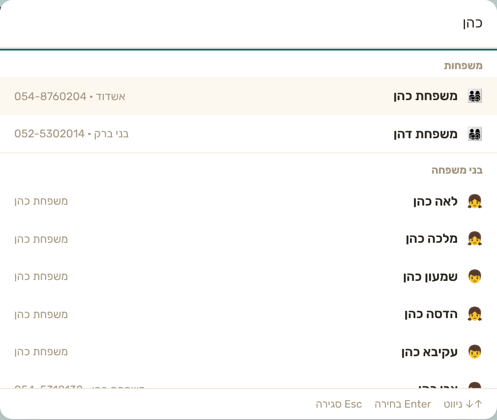</a><br><sub>🔍 חיפוש מהיר Ctrl+K</sub></td>
<td align="center"><a href="docs/screenshots/guide/04-add-event.png">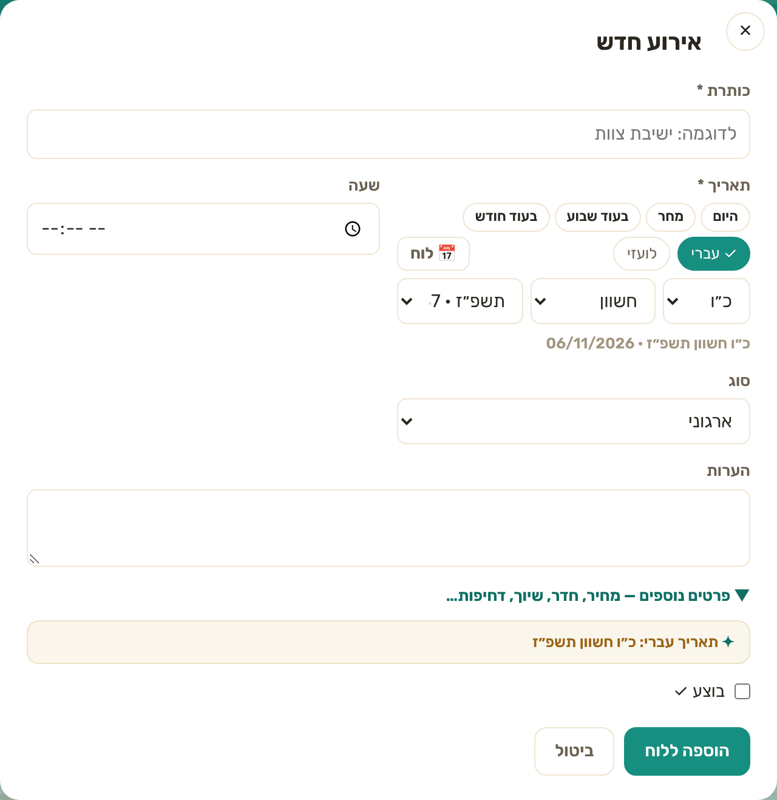</a><br><sub>➕ אירוע בתאריך עברי</sub></td>
<td align="center"><a href="docs/screenshots/guide/08-accessibility.png">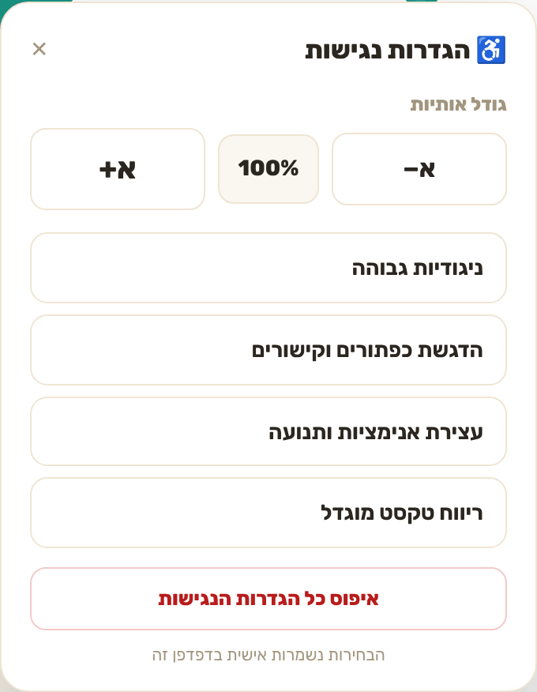</a><br><sub>♿ נגישות</sub></td>
</tr>
<tr>
<td colspan="3" align="center"><sub>📱 iPhone</sub><br>
<a href="docs/screenshots/mobile/families.png">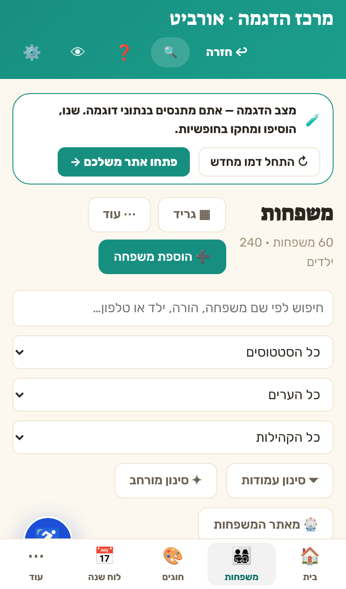</a>
<a href="docs/screenshots/mobile/family-card.png">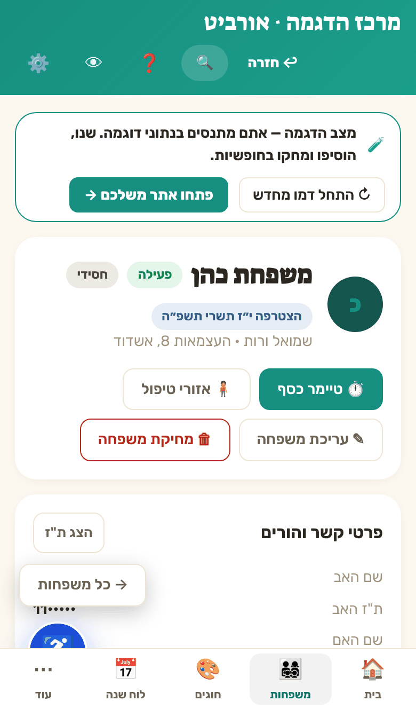</a>
<a href="docs/screenshots/mobile/calendar.png">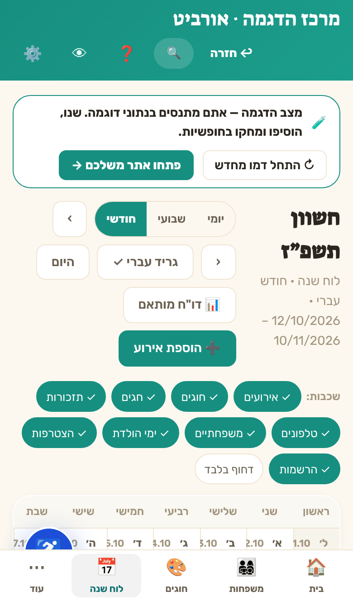</a>
<a href="docs/screenshots/mobile/search.png">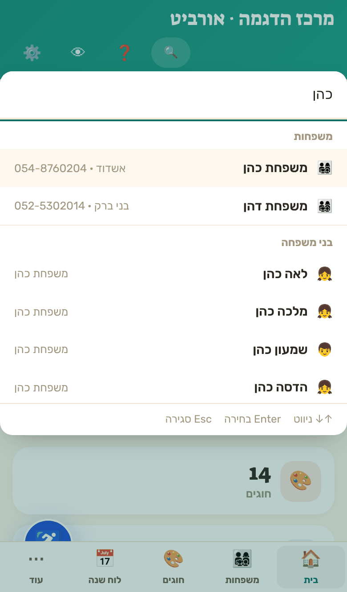</a>
</td>
</tr>
</table>

איך עושים כל אחד מאלה, צעד אחר צעד: [`docs/GUIDE.he.md`](docs/GUIDE.he.md).

## הרצה מקומית ב-20 שניות

<picture>
  <source media="(prefers-color-scheme: light)" srcset="assets/install.light.svg">
  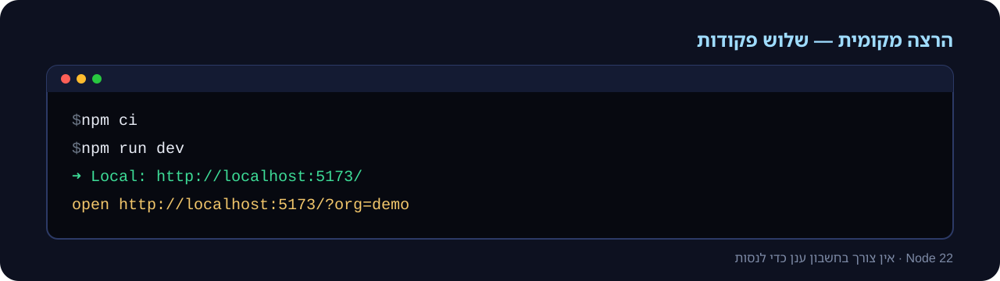
</picture>

דרישות: Node 22 (ראו `.nvmrc`).

</div>

```bash
git clone https://github.com/meir7651231-ui/maor-system.git && cd maor-system
npm ci
npm run dev          # ← http://localhost:5173/?org=demo
```

<div dir="rtl">

**נמדד מ-clone נקי (2026-11-06, ‏Node 22.23):** ‏clone ‏2.2 שנ׳ · ‏`npm ci` ‏15.2 שנ׳ · שרת פיתוח מוכן 0.7 שנ׳ — **18.2 שנ׳ בסך הכול** עד שהדמו עולה. עם מטמון npm ריק, `npm ci` לקח 13.7 שנ׳ (תלוי ברשת).

</div>

```bash
npm run verify:fast  # typecheck → lint → unit tests (no build)
npm run verify       # full gate: + build
npm run e2e          # browser matrix (needs a build first)
```

<div dir="rtl">

הפלט של `npm run build` הוא תיקיית `dist` סטטית (נתיבים יחסיים) — עולה לכל אחסון סטטי.
ב-repo מוגדרים hooks בתיקייה ‎`.githooks`‎: לפני commit רצים typecheck, lint ובדיקות; לפני push רץ build מלא, ו-push ל-main נחסם.

## מתי לבחור בנו — ומתי לא

| ✅ מתאים כש... | ❌ פחות מתאים כש... |
|---|---|
| מנהלים **משפחות, חוגים, נוכחות ותורמים** — עמותות, מרכזים קהילתיים ודתיים, מוסדות חינוך | צריכים **סליקת אשראי מובנית** בתוך המערכת (כאן יש רק קישור לעמוד-סליקה של הארגון) |
| צריכים **לוח עברי** אמיתי: חגים, תאריכים עבריים, חזרתיות לפי תאריך עברי | צריכים **הנהלת-חשבונות** או דיווח לרשויות המס |
| מנפיקים **קבלות במספור רציף** (סעיף 46) | הצוות עובד ב**שפה אחרת מעברית** (ממשק הניהול בעברית בלבד) |
| רוצים ש**הנתונים יישארו אצלכם**, בלי שרת חובה ובלי מנוי | נדרשים כבר היום ל-**MFA** או ל-SSO ארגוני |
| מפעילים **כמה ארגונים** מאותה בנייה (white-label) | צריכים **עבודה מרובת-מכשירים בלי ענן** (סנכרון דורש Firebase) |

## מה זה לא עושה

- **לא סולקת כרטיסי אשראי.** קישורי-תשלום מובילים לעמוד-הסליקה של הארגון עצמו. ה-webhook בשרת רק רושם "תשלום נכנס" לאישור, ולא מנפיק קבלה לבד.
- **אינה מערכת הנהלת-חשבונות** ואינה מדווחת לרשויות המס. היא מפיקה קבלות במספור רציף, וזה הכול.
- **בלי ענן אין סנכרון בין מכשירים.** במצב מקומי הנתונים בדפדפן אחד, והגיבוי (קובצי JSON יומיים) באחריות הארגון.
- **לא שולחת SMS או מייל בלי שרת.** התורים האלה דורשים פריסת Firebase Functions ופרטי-שליחה של כל ארגון בכספת שלו.
- **אין אימות דו-שלבי (MFA).** הכניסה לענן היא באימייל וסיסמה בלבד.
- **ממשק הניהול בנוי לעברית ומימין לשמאל.** אין מתג-שפה לאפליקציה עצמה.

## תיעוד

| מסמך | מה יש בו |
|---|---|
| [`docs/ARCHITECTURE.he.md`](docs/ARCHITECTURE.he.md) · [EN](docs/ARCHITECTURE.md) | שרשרת השערים, שכבות הנתונים, סנכרון והחלטות מפתח |
| [`docs/GUIDE.he.md`](docs/GUIDE.he.md) | 9 משימות נפוצות, צעד אחר צעד עם צילומים |
| [`CONTRIBUTING.md`](CONTRIBUTING.md) | סביבה, שערים, מוסכמות, PR |
| [`ROADMAP.md`](ROADMAP.md) | מה מתוכנן ובאיזה מצב |
| [`CHANGELOG.md`](CHANGELOG.md) | היסטוריה בפורמט Keep a Changelog + הצעת SemVer |
| [`SECURITY.md`](SECURITY.md) | דיווח פרטי על חולשות |

## מבנה הקוד

</div>

```
├── src/
│   ├── App.tsx            # shell: navigation, gate chain (decrypt → cloud → lock)
│   ├── types/             # data model (domain.ts), flags & terms (features.ts), config
│   ├── store/             # Zustand: useApp.ts (actions), persist.ts (persistence + migration), cloudSync.ts
│   ├── lib/               # pure logic: Hebrew calendar, crypto, receipts, import/export, config
│   ├── components/        # one module per area — pure lib.ts + components + __tests__
│   └── styles/            # themes, RTL, accessibility, print
├── public/                # PWA (manifest, sw.js), icons, sample configs (c/<slug>/)
├── functions/             # optional Firebase Functions (nightly backup, mail/SMS outboxes, …)
├── telephony/             # config-as-data PBX routing engine
├── e2e/                   # Playwright scripts (user journeys, matrices, Rules red-team)
├── scripts/               # build tools (bundle budget, icons, screenshots)
├── docs/                  # architecture, user guide, screenshots
├── knowledge/             # planning docs, audits and close-out reports (Hebrew)
├── firestore.rules        # cloud security rules
└── assets/                # README images (dark + light variants)
```

<div dir="rtl">

כל מודול בנוי כ-`lib.ts` טהור (בלי store/DOM) שנבדק ביחידה, ורכיבים מעליו. באג שתוקן מקבל בדיקת "ratchet" שמונעת חזרה.

## שאלות נפוצות

<details><summary><b>צריך שרת?</b></summary>

לא. בלי ענן האתר סטטי לחלוטין. Firebase (סנכרון, הרשמה, Functions) הוא opt-in פר-ארגון דרך `config.json`, ונטען דינמית רק כשמוגדר.
</details>

<details><summary><b>איפה הנתונים נשמרים, ואיך לא מאבדים אותם?</b></summary>

בדפדפן של המכשיר, בשלוש שכבות (ראו <a href="#איך-זה-עובד">איך זה עובד</a>). במצב מקומי-בלבד: לעבוד מאותו מחשב ודפדפן, לשמור את קובצי הגיבוי היומיים בתיקייה מסונכרנת, לא לעבוד בגלישה פרטית ולא לנקות נתוני-אתר. מעבר מחשב = ייצוא גיבוי ⇒ ייבוא במסך ההגדרות.
</details>

<details><summary><b>מה קורה למה שאני עושה בדמו החי?</b></summary>

הדמו עובד בלי ענן, ולכן כל שינוי נשמר רק בדפדפן שלכם. **↻ התחל דמו מחדש** מחזיר את נתוני הדוגמה.
</details>

<details><summary><b>אפשר להתאים לתחום שלנו?</b></summary>

כן — דרך אשף ההרכבה או `config.json`: חבילת-תחום, הדלקה וכיבוי של מודולים ודגלים, שינוי מונחים, ערכת נושא וצבע.
</details>

<details><summary><b>אפשר להתקין כאפליקציה?</b></summary>

כן. האתר הוא PWA (manifest + service worker), ניתן להתקנה למסך הבית ועובד גם בלי אינטרנט אחרי הטעינה הראשונה.
</details>

## סטטוס

בפיתוח פעיל ובשימוש בפרודקשן; כרגע בהקפאת פיצ'רים (ראו [`ROADMAP.md`](ROADMAP.md)).
אין כרגע קובץ רישיון ב-repo, ולכן אין הרשאת שימוש מעבר לצפייה בקוד.

</div>
