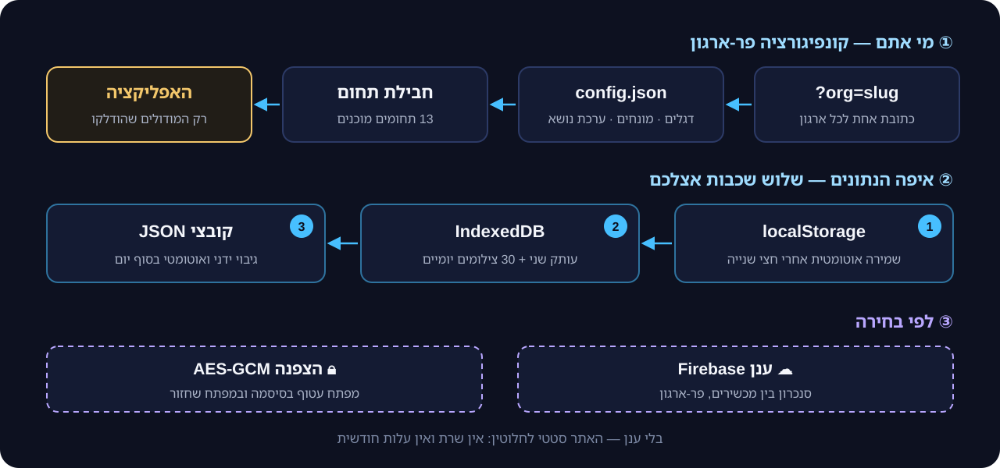
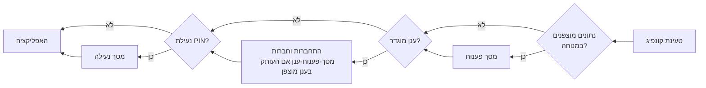
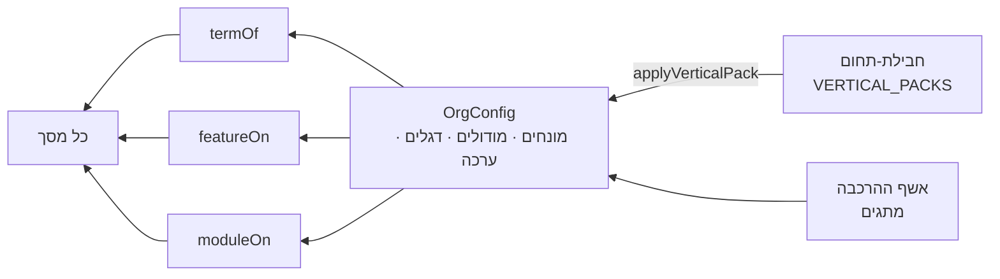

<a href="ARCHITECTURE.md">English</a> · <b>עברית</b>

# ארכיטקטורה

אורביט היא **אפליקציית עמוד-יחיד סטטית, local-first**. בנייה אחת משרתת כל ארגון: מי אתם נקבע בקונפיגורציה, ואיפה הנתונים — אתם מחליטים. כל מה שכתוב כאן לקוח מהקוד, וההפניות מצביעות על מקום כל חלק.

<picture>
  <source media="(prefers-color-scheme: light)" srcset="../assets/how.light.svg">
  
</picture>

## הסטאק

React 19 · TypeScript · Vite 8 · Zustand (store יחיד) · `idb` ‏(IndexedDB) · Firebase (נטען ב-`import()` דינמי רק כשהארגון הגדיר אותו) · Three.js (רק לרקע מסך ההרשמה, ב-chunk נפרד).

## עלייה ושרשרת השערים

`src/App.tsx` הוא השלד: הניווט נמצא ב-store (בלי router), ומודאלים ממוענים ב-hash. לפני שמסך כלשהו מוצג, האפליקציה עוברת שרשרת שערים:

## קונפיגורציה (White-label)

`loadOrgConfig()` ב-`src/lib/config.ts` מזהה את הארגון בסדר הזה:

1. ‏`?org=<slug>` (או דומיין שממופה ל-slug) ⇐ קונפיג-הענן השמור לאותו slug אם יש, אחרת `public/c/<slug>/config.json` — פריסה אחת משרתת כל מספר ארגונים;
2. דריסה ב-`localStorage` ‏(`maor_org_config`, נכתבת מאשף ההרכבה) — רק כשהיא שייכת לאותו slug, ולעולם לא דריסת-הדמו בשורש;
3. ‏`./config.json` לצד הבנייה;
4. ‏`DEFAULT_CONFIG` כשדבר לא נטען.

כל קונפיג עובר `normalizeConfig`, שמחטא אותו ברשימות-מותרות (ערכות נושא, תנועה, הרחבות, תבניות, כתובות https בלבד).

קונפיג נושא **דגלי-פיצ'ר** (`src/types/features.ts`, ‏328 כיום), **מונחים** (46 — איך קוראים אצלכם ל"משפחה", "חוג", "תורם"), **ערכת נושא** (4) ואופציונלית **חבילת-תחום** (`src/lib/verticalPacks.ts`, ‏13) שקובעת יחד מודולים, מונחים, ערכה, צבע ואייקון.

## הליבה: קונפיג → termOf / featureOn / moduleOn

כל מה שגורם לארגון אחד להיראות ולהתנהג אחרת מארגון אחר עובר דרך **שלוש פונקציות טהורות** ב-`src/lib/config.ts`. רכיבים לא בודקים "איזה ארגון זה" — הם שואלים את הקונפיג:

| פונקציה | החוזה | מופיעה ב- (grep, שורות ב-`src/`) |
|---|---|---|
| `termOf(cfg, key, fallback)` | המילה של הארגון למושג ("מטופלים" במקום "משפחות"); ריק או חסר ⇐ ברירת-המחדל | 925 |
| `featureOn(cfg, key)` | **חסר = פעיל, רק `false` מכבה**; דגל-אב שכבוי מכבה את צאצאיו, וגם כיבוי המודול (הקטע הראשון של המפתח) | 634 |
| `moduleOn(cfg, module)` | מודול-ניווט מוצג אלא אם `modules[m] === false` | 81 |

**חבילת-תחום** היא פשוט ערכה מוכנה לקונפיג הזה: `applyVerticalPack(config, packId)` (`src/lib/verticalPacks.ts`) מחליף את `terms`, `modules` ו-`features` בערכי החבילה, ומחיל את ערכת-הנושא, הצבע, האייקון והתנועה שלה. צבע שהארגון בחר ידנית (`accentCustom`) נשמר. התחום שהלקוח בוחר בהרשמה (`lib/signupWizard.ts`, שלב 1) נזרע כחבילת-הפתיחה כשהבעלים מאשר את הבקשה בלוח-הבקרה (`PlatformPanel` ← `applyVerticalPack`); משם אשף ההרכבה (`#builder`) מכוונן את אותו קונפיג — כך ה"התאמה" לכל ארגון היא נתונים, לא קוד.

מטריצת-דפדפן (`npm run e2e:verticals`) טוענת את הקונפיג שכל חבילה מייצרת, עוברת על כל המסכים, ונכשלת אם מונח-ברירת-מחדל דולף במקום המונח של החבילה.

## נתונים והתמדה

כל המידע הוא **מסמך אחד** (`Db` ב-`src/types/domain.ts`, ‏`DB_VERSION = 6`) עם 23 אוספי-ישויות ומונים. מספרי הקבלות מגיעים ממונים ייעודיים ורציפים (`receiptSeq`, `donationSeq`).

`src/store/persist.ts` כותב אותו בשלוש שכבות:

| שכבה | מתי | למה |
|---|---|---|
| `localStorage` | חצי שנייה אחרי כל שינוי (debounce) | שחזור מיידי ברענון |
| `IndexedDB` | במקביל, ועוד טבעת של **30 צילומים יומיים** | עותק שני וריפוי-עצמי |
| קובצי גיבוי JSON | הורדה ידנית, ואוטומטית בסוף יום | עותק מחוץ לדפדפן |

בטעינה, `migrate()` מצטבר אחד מרפא מידע ישן או פגום (מונים, מספרי-קבלה כפולים, מזהי בני-בית) לפני שהאפליקציה רואה אותו. שער ריבוי-טאבים מאזין לאירועי `storage`, כדי ששתי לשוניות לא ידרסו זו את זו.

## סנכרון ענן (לפי בחירה)

כשיש `config.firebase`, ‏`src/store/cloudSync.ts` מחבר את ה-store ל-Firestore (`src/lib/cloud*.ts`):

- **התחברות ראשונה:** ענן ריק מקבל העלאה מלאה; ענן מלא מחליף את העותק המקומי (השכבות המקומיות ממשיכות לכתוב — הענן הוא שכבה נוספת, לא תחליף);
- **עדכונים חיים:** שינויים מרוחקים ממוזגים ל-store בלי הד חזרה;
- **שינויים מקומיים:** ‏debounce של 800ms, חישוב הפרש (`diffDb`) ודחיפה פר-אוסף;
- **מחיקות** משאירות מצבות (`delLog`), כך שמכשיר לא-מקוון לא מחזיר אותן לחיים;
- **כתיבת קונפיג** לענן היא תיקון שדה-שדה, לעולם לא תצלום מלא.

ההרשאות נאכפות ב-`firestore.rules` (מיילים מורשים, מנהל-ארגון, צוות), ונבדקות מול אמולטור ב-CI (`npm run test:rules`).

## החלטות מפתח

1. **local-first ואחסון סטטי.** לא צריך שרת כדי להריץ; הנתונים בדפדפן של הארגון עם שלוש שכבות הגנה. הענן הוא opt-in פר-ארגון.
2. **White-label בקונפיגורציה, לא בפיצול-קוד.** קוד אחד, בנייה אחת; כל ארגון הוא `config.json`. מונחים עוברים דרך `termOf`, פיצ'רים דרך `featureOn`.
3. **חוזה הדגלים: מפתח חסר = פעיל, רק `false` מכבה.** כיבוי דגל-אב מכבה את צאצאיו (`featureOn`). פיצ'רים שאסור שיידלקו מעצמם משתמשים ב-opt-in מפורש `=== true`.
4. **לוגיקה טהורה ובדוקה.** כל מודול הוא `lib.ts` טהור (בלי store ובלי DOM) עם בדיקות יחידה לצידו; כל באג שתוקן מקבל בדיקת "ratchet".
5. **הכסף נשאר רציף.** מוני הקבלות רק עולים, מיזוג-ענן לעולם לא מוריד אותם, ומודולים מבודדים (חנות, קופות צדקה, חלוקה) לא כותבים לתרומות או לקבלות.

## איפה לחפש

| תחום | קבצים |
|---|---|
| שלד, שערים, ניווט | `src/App.tsx` |
| מודל הנתונים | `src/types/domain.ts` |
| דגלים ומונחים | `src/types/features.ts`, `src/lib/config.ts` |
| ה-store (כל הפעולות העסקיות) | `src/store/useApp.ts` |
| התמדה ומיגרציה | `src/store/persist.ts` |
| ענן | `src/store/cloudSync.ts`, `src/lib/cloud*.ts`, `firestore.rules` |
| לוח עברי | `src/lib/hebrew.ts`, `src/lib/hebdate.ts` (על `Intl` בלבד) |
| הצפנה ונעילת PIN | `src/lib/crypto.ts`, `src/lib/lock.ts`, `src/lib/cloudCrypto.ts` |
| פונקציות שרת (לפי בחירה) | `functions/index.js` |

