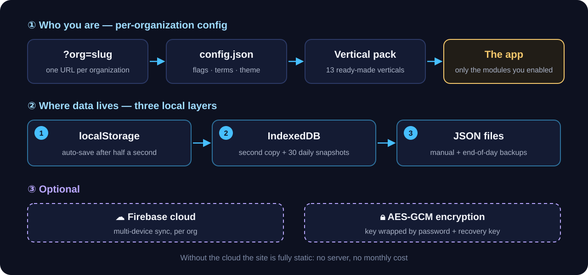
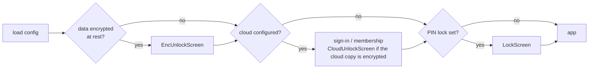

<b>English</b> · <a href="ARCHITECTURE.he.md">עברית</a>

# Architecture

Orbit is a **static, local-first single-page app**. One build serves every organization; who you are is decided by configuration, and where your data lives is decided by you. Everything below is taken from the code; file references point to where each piece lives.

<picture>
  <source media="(prefers-color-scheme: light)" srcset="../assets/how.en.light.svg">
  
</picture>

## Stack

React 19 · TypeScript · Vite 8 · Zustand (one store) · `idb` (IndexedDB) · Firebase (loaded with a dynamic `import()` only when an organization configures it) · Three.js (sign-up hero only, in its own lazy chunk).

## Startup and the gate chain

`src/App.tsx` is the shell: navigation lives in the store (no router), and modals are addressed by URL hash. Before any screen renders, the app passes a chain of gates:

## Configuration (white-label)

`loadOrgConfig()` in `src/lib/config.ts` resolves the organization in this order:

1. a runtime override in `localStorage` (`maor_org_config`, written by the setup wizard);
2. `?org=<slug>` ⇒ `public/c/<slug>/config.json` — one deployment serves any number of organizations;
3. `./config.json` next to the build;
4. `DEFAULT_CONFIG` when nothing loads.

Every loaded config goes through `normalizeConfig`, which sanitizes it with allow-lists (themes, motion, integrations, templates, https-only URLs).

A config carries **feature flags** (`src/types/features.ts`, 328 today), **terms** (46 — what this organization calls a "family", a "class", a "donor"), a **theme** (4) and optionally a **vertical pack** (`src/lib/verticalPacks.ts`, 13) that sets modules, terms, theme, accent and icon together.

## Data and persistence

The whole dataset is **one document** (`Db` in `src/types/domain.ts`, `DB_VERSION = 6`) with 23 entity collections plus counters. Receipt numbers come from dedicated, strictly sequential counters (`receiptSeq`, `donationSeq`).

`src/store/persist.ts` writes it through three layers:

| Layer | When | Purpose |
|---|---|---|
| `localStorage` | 500 ms after each change (debounced) | instant restore on reload |
| `IndexedDB` | alongside, plus a ring of **30 daily snapshots** | second copy and self-recovery |
| JSON backup files | manual download, and automatic at end of day | copy outside the browser |

On load, a single cumulative `migrate()` heals older or damaged data (counters, duplicate receipt ids, member ids) before the app sees it. A multi-tab guard listens to `storage` events so two tabs do not overwrite each other.

## Cloud sync (optional)

When `config.firebase` is present, `src/store/cloudSync.ts` connects the store to Firestore (`src/lib/cloud*.ts`):

- **first sign-in:** an empty cloud receives a full upload; a populated cloud replaces the local copy (local layers keep writing — the cloud is an extra layer, not a replacement);
- **live updates:** remote changes are merged into the store without echoing them back;
- **local changes:** debounced 800 ms, diffed (`diffDb`) and pushed per collection;
- **deletions** leave tombstones (`delLog`) so an offline device cannot resurrect them;
- **config writes** to the cloud are field-by-field patches, never full snapshots.

Access is enforced by `firestore.rules` (allow-listed e-mails, org manager, staff), which is red-teamed against the emulator in CI (`npm run test:rules`).

## Key decisions

1. **Local-first, static hosting.** No server is required to run the app; data stays in the organization's browser with three layers of protection. The cloud is opt-in per organization.
2. **White-label by configuration, not by fork.** One codebase, one build; each organization is a `config.json`. Terms go through `termOf`, features through `featureOn`.
3. **Flag contract: a missing key means on, only `false` turns off.** Turning off a parent flag turns off its children (`featureOn`). Features that must never switch on by default use an explicit `=== true` opt-in instead.
4. **Pure logic, tested.** Each module is a pure `lib.ts` (no store, no DOM) with unit tests beside it; every fixed bug gets a "ratchet" test that keeps it fixed.
5. **Money stays sequential.** Receipt counters only move forward, cloud merges never decrease them, and isolated modules (shop, charity boxes, distribution) never write into donations or receipts.

## Where to look

| Area | Files |
|---|---|
| Shell, gates, navigation | `src/App.tsx` |
| Data model | `src/types/domain.ts` |
| Flags and terms | `src/types/features.ts`, `src/lib/config.ts` |
| Store (all business actions) | `src/store/useApp.ts` |
| Persistence and migration | `src/store/persist.ts` |
| Cloud | `src/store/cloudSync.ts`, `src/lib/cloud*.ts`, `firestore.rules` |
| Hebrew calendar | `src/lib/hebrew.ts`, `src/lib/hebdate.ts` (built on `Intl` only) |
| Encryption and PIN lock | `src/lib/crypto.ts`, `src/lib/lock.ts`, `src/lib/cloudCrypto.ts` |
| Server functions (optional) | `functions/index.js` |
