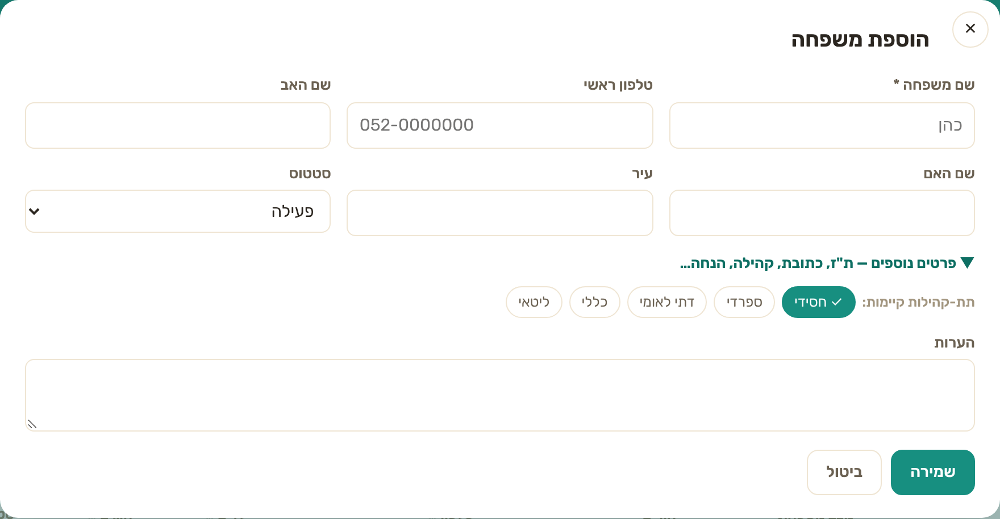
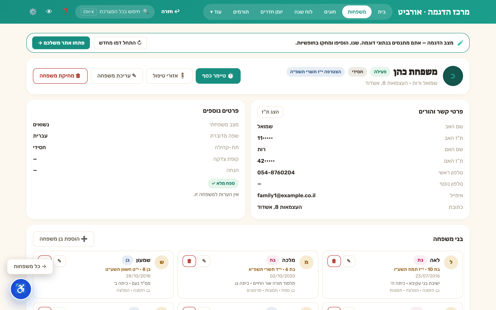
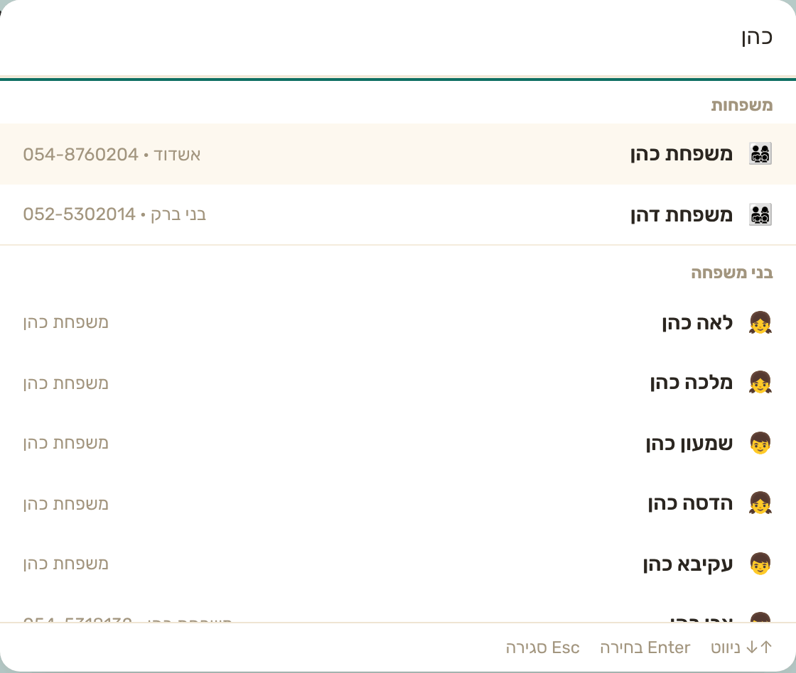
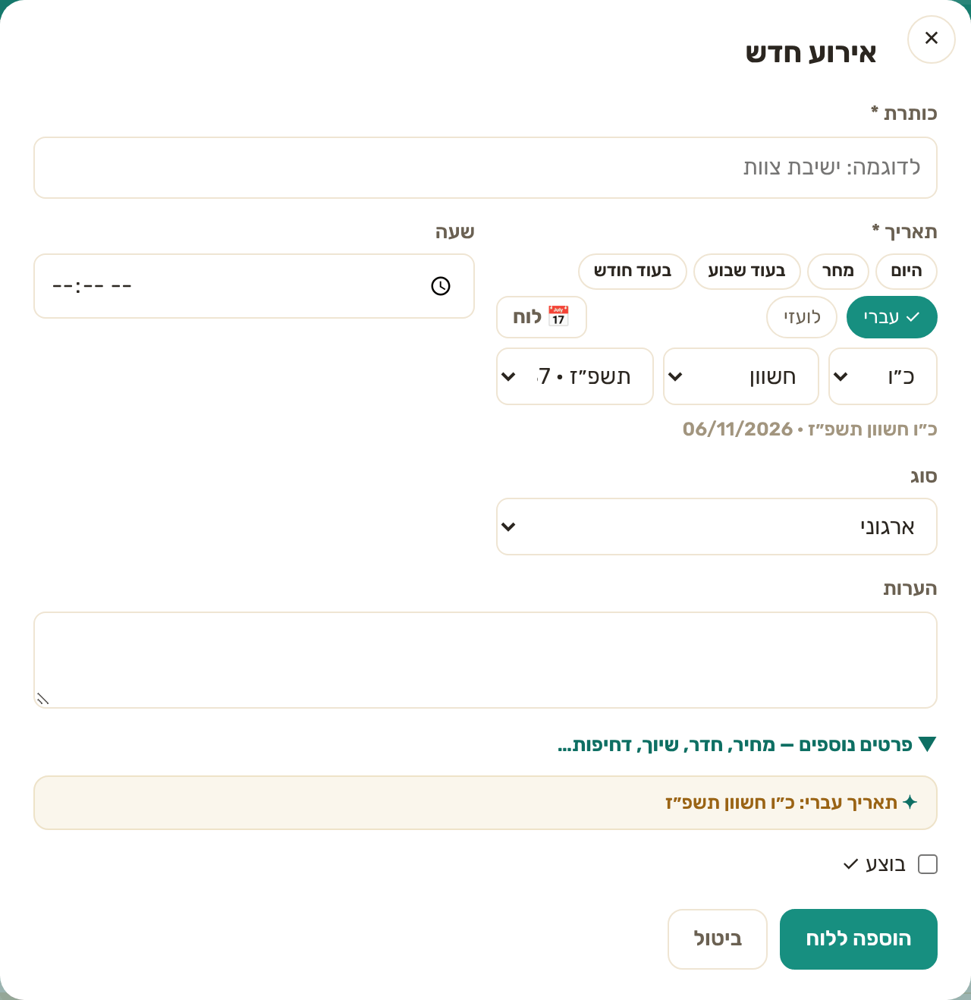
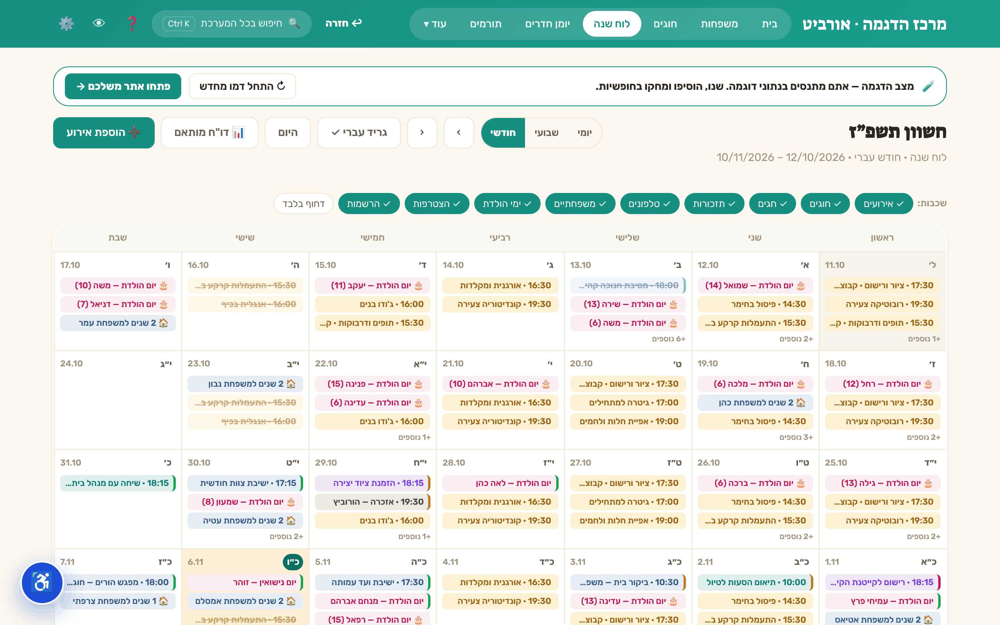
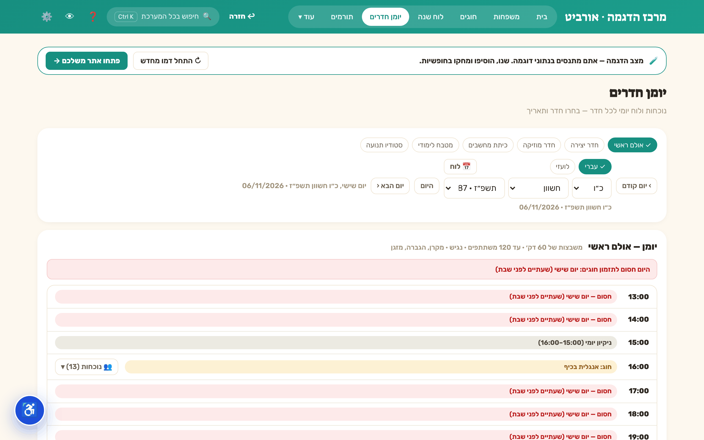
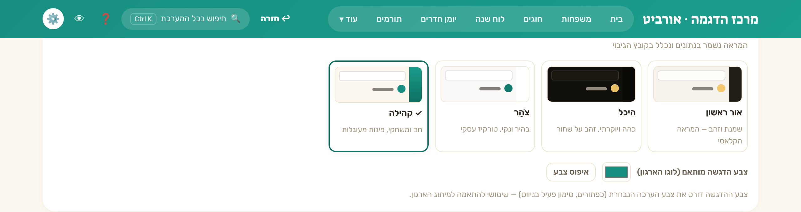
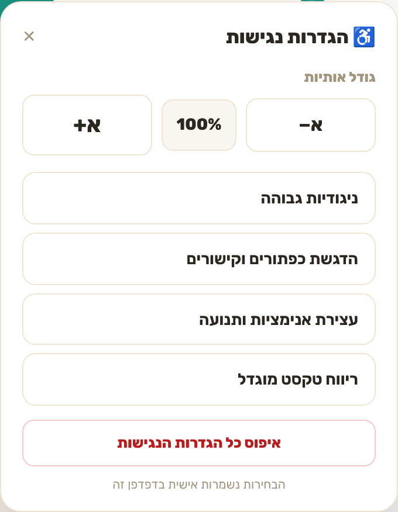

# מדריך משימות נפוצות

תשע משימות שעושים כל יום, עם צילומים מהאתר החי (`orbit-il.com/?org=demo`, צולמו ב-6.11.2026; נתונים מומצאים).
אפשר לנסות כל אחת מהן בדמו החי: **[orbit-il.com/?org=demo](https://orbit-il.com/?org=demo)**. שום דבר שתעשו שם לא נשמר אצל אף אחד אחר.

> המונחים במדריך הם של חבילת "עמותה" (משפחות, חוגים, תורמים). בארגון אחר המילים יכולות להיות שונות, למשל "לקוחות" במקום "משפחות" — המסכים זהים.

**תוכן:** [הוספת משפחה](#1-הוספת-משפחה) · [כרטיס משפחה](#2-כרטיס-משפחה) · [חיפוש מהיר](#3-חיפוש-מהיר-בכל-המערכת) · [הוספת אירוע](#4-הוספת-אירוע-ללוח) · [לוח שנה עברי](#5-לוח-השנה-בגריד-עברי) · [יומן חדרים](#6-יומן-חדרים) · [ערכת נושא](#7-החלפת-ערכת-נושא-וצבע) · [נגישות](#8-הגדרות-נגישות) · [גיבוי ושחזור](#9-גיבוי-ושחזור)

---

## 1. הוספת משפחה

1. בתפריט העליון: **משפחות**.
2. לוחצים **➕ הוספת משפחה**.
3. ממלאים לפחות **שם משפחה** (שדה החובה היחיד). טלפון, שמות ההורים, עיר וסטטוס — לפי הצורך.
4. **פרטים נוספים** נפתח בלחיצה: ת"ז, כתובת, קהילה ועוד.
5. **שמירה**.

## 2. כרטיס משפחה

לוחצים על שורה ברשימת המשפחות, והכרטיס נפתח:

- **פרטי קשר והורים**. מספרי ת"ז מוסתרים עד שלוחצים **הצג ת"ז**.
- **בני משפחה** עם גיל, תאריך לידה עברי ולועזי, וכפתור **➕ הוספת בן משפחה**.
- למעלה: **עריכת משפחה**, וכפתורים נוספים לפי המודולים שמופעלים בארגון.
- **← כל המשפחות** (בפינה) מחזיר לרשימה, באותו מקום גלילה ועם אותם מסננים.

## 3. חיפוש מהיר בכל המערכת

1. לוחצים **Ctrl+K** (או על שדה **חיפוש בכל המערכת** בכותרת).
2. מקלידים שם, טלפון או חלק ממנו.
3. התוצאות מקובצות לפי סוג (משפחות, בני משפחה ועוד). חיצים לניווט, **Enter** לפתיחה, **Esc** לסגירה.

## 4. הוספת אירוע ללוח

1. **לוח שנה** ← **➕ הוספת אירוע**.
2. **כותרת** (חובה), תאריך — אפשר לבחור **עברי** או **לועזי**, וקיצורים כמו היום/מחר/בעוד שבוע.
3. שעה, סוג והערות לפי הצורך.
4. **הוספה ללוח**.

## 5. לוח השנה בגריד עברי

- בחירת תצוגה: **יומי / שבועי / חודשי**, וכפתור **גריד עברי** להצגת החודש העברי.
- **היום** חוזר לתאריך הנוכחי, והחיצים עוברים חודש.
- **שכבות** (צ'יפים בראש הלוח) מסננות מה מוצג: אירועים, חוגים, ימי הולדת, הנצחות ועוד.

## 6. יומן חדרים

- **יומן חדרים** מציג את תפוסת כל חדר לפי שעות.
- ימים שבהם אסור לתפוס חדר (שבת, חגים וצומות) מסומנים וחסומים.
- החדרים עצמם מוגדרים בהגדרות ← חדרים.

## 7. החלפת ערכת נושא וצבע

1. ⚙️ **הגדרות** ← **ערכת נושא**.
2. בוחרים אחת מארבע הערכות: **אור ראשון**, **היכל**, **צֹהַר**, **קהילה**.
3. אופציונלי: **צבע הדגשה מותאם** (למשל צבע הלוגו). **איפוס צבע** מחזיר לברירת המחדל.

## 8. הגדרות נגישות

לוחצים על כפתור הנגישות ♿ בפינת המסך:

- **גודל אותיות** (‎−א / 100% / ‎+א).
- **ניגודיות גבוהה**, **הדגשת כפתורים וקישורים**, **עצירת אנימציות ותנועה**, **ריווח טקסט מוגדל**.
- **איפוס כל הגדרות הנגישות**. ההעדפות נשמרות בדפדפן של כל אדם.

## 9. גיבוי ושחזור

> במצב הדגמה הלשונית הזו מוסתרת, ולכן אין לה צילום.

1. ⚙️ **הגדרות** ← **📚 נתונים**.
2. **⬇ הורדת גיבוי מלא** שומר קובץ JSON. גם בסוף כל יום עבודה יורד גיבוי אוטומטי.
3. **שחזור** מקובץ גיבוי או מאחד מ-30 הצילומים היומיים. השחזור דו-שלבי (בחירה ← אישור).
4. בארגון שמחובר לענן, שחזור מותר למנהל-הארגון בלבד, כי הוא דורס את הנתונים בכל המכשירים.

---

עוד: [ארכיטקטורה](ARCHITECTURE.he.md) · [README](../README.md)

